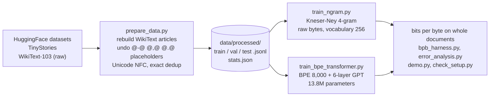
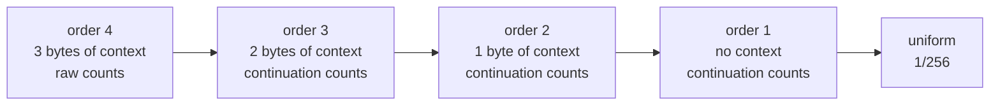
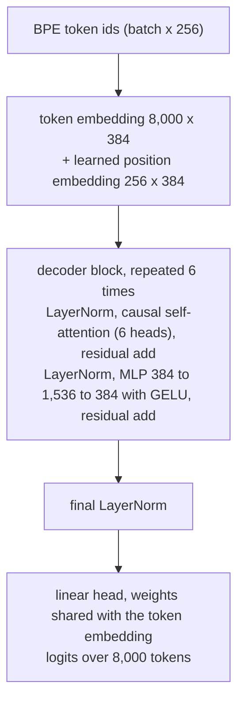

# kv-cache-nlp

Byte-level language modelling baselines for a study of patch-aware KV-cache compression.
CS F429 (Natural Language Processing), Group 12.

This repository holds Part 2 of the project: a data pipeline for two corpora of very
different difficulty (TinyStories and WikiText-103), two language-model baselines trained on
both (a byte-level Kneser-Ney 4-gram model and a 13.8M-parameter BPE Transformer), an
evaluation harness that scores both in bits per byte on identical documents, an error
analysis, and an interactive command-line demo. All trained models and processed data are
published as a GitHub Release, so the demo runs on a fresh laptop without any training.

| Evaluation set (same documents for both models) | Kneser-Ney 4-gram | BPE Transformer | Reduction |
|---|---|---|---|
| TinyStories validation, first 500 documents | 1.8085 | **0.6939** | 61.6% |
| WikiText-103 validation, all 60 documents | 2.4103 | **1.5200** | 36.9% |
| WikiText-103 test, all 62 documents | 2.4381 | **1.5309** | 37.2% |

Bits per byte, lower is better; 8.0 means no compression at all. Every number in this table
is recomputed from the released files by `python scripts/check_setup.py --full`.

## Contents

1. [Quickstart](#quickstart)
2. [Demo in 30 minutes](#demo-in-30-minutes)
3. [What the release contains](#what-the-release-contains)
4. [The project in brief](#the-project-in-brief)
5. [Data](#data)
6. [Classical baseline: Kneser-Ney byte 4-gram](#classical-baseline-kneser-ney-byte-4-gram)
7. [Modern baseline: BPE Transformer](#modern-baseline-bpe-transformer)
8. [Evaluation: bits per byte](#evaluation-bits-per-byte)
9. [Results](#results)
10. [Repository map](#repository-map)
11. [Reproducing every number from scratch](#reproducing-every-number-from-scratch)
12. [Design decisions and lessons](#design-decisions-and-lessons)
13. [Troubleshooting](#troubleshooting)
14. [Next: Part 3](#next-part-3)

## Quickstart

You need Python 3.10 or newer (tested with 3.13.7) and Git. A GPU is optional: everything,
including the demo, runs on a CPU.

The steps are the same on every platform. Only the virtual-environment activation differs.

**Windows (PowerShell)**

```powershell
git clone https://github.com/cfcmadlad/kv-cache-nlp.git
cd kv-cache-nlp
python -m venv .venv
.venv\Scripts\Activate.ps1
```

If PowerShell refuses to run `Activate.ps1`, allow scripts for this window only with
`Set-ExecutionPolicy -Scope Process -ExecutionPolicy Bypass` and run it again.

**Linux and macOS**

```bash
git clone https://github.com/cfcmadlad/kv-cache-nlp.git
cd kv-cache-nlp
python3 -m venv .venv
source .venv/bin/activate
```

**Then, on every platform, install PyTorch.** Pick exactly one of these two lines. Use the
CUDA build if you have an NVIDIA GPU (`nvidia-smi` shows the highest CUDA version your driver
supports; cu126 suits current drivers). Otherwise use the CPU build. macOS only has one
build, so on a Mac run `pip install torch`.

```bash
pip install torch --index-url https://download.pytorch.org/whl/cu126
```

```bash
pip install torch --index-url https://download.pytorch.org/whl/cpu
```

**Install the remaining packages, fetch the trained models, check, and start the demo.**

```bash
pip install -r requirements.txt
```

```bash
python scripts/fetch_assets.py
```

```bash
python scripts/check_setup.py
```

```bash
python scripts/demo.py
```

How long each step takes. The clone, fetch and check rows were measured from a fresh clone of
this repository on our laptop and home connection; the install rows are typical:

| Step | Time | Notes |
|---|---|---|
| `git clone` | 2 seconds | The repository is under 1 MB. |
| Create the virtual environment | about 10 seconds | |
| Install PyTorch | several minutes | The CUDA wheel is about 2.5 to 3 GB, the CPU wheel about 200 MB. This is by far the slowest step, and it happens once. |
| `pip install -r requirements.txt` | under a minute | Mostly the `datasets` package, which only `prepare_data.py` needs. |
| `python scripts/fetch_assets.py` | about 75 seconds | Downloads the 138 MB zip from the GitHub release, verifies its SHA-256 and unpacks 219 MB. Mostly download time, so it depends on your connection. A stalled connection times out after 30 seconds and is retried up to three times. |
| `python scripts/check_setup.py` | 5 to 10 seconds | Measured on both GPU and CPU. Loads all four models; no training. |

With PyTorch already installed, clone to PASS took 85 seconds, almost all of it the download.

When `check_setup.py` ends with `PASS`, you are ready for the review. If it prints `FAIL`, the
message under it says what to run; see also [Troubleshooting](#troubleshooting).

## Demo in 30 minutes

The demo is a menu-driven program, `python scripts/demo.py`. A suggested running order:

1. **Start option 1 first, because it trains live.** Choose a dataset and a model. The demo
   runs the real training script in a small configuration, so the examiner sees the same
   progress bars and loss log a full run prints:
   - n-gram: order 4, the first 3,000 training documents, scored on 300 validation documents.
   - transformer: a fresh 2,000-token BPE vocabulary learned from the first 3,000 training
     documents, then 300 optimizer steps with validation loss printed every 50 steps.

   Everything this option writes goes to `checkpoints/demo/`. It never touches the real
   checkpoints in `checkpoints/`, so a live run cannot change the reported results.

   Measured run times for option 1:

   | Choice | NVIDIA RTX 4060 Laptop GPU | CPU only |
   |---|---|---|
   | n-gram, TinyStories | 9 s | 9 s (the n-gram never uses the GPU) |
   | n-gram, WikiText-103 | 147 s | about the same (3,000 WikiText documents are 51 MB of text to count) |
   | transformer, TinyStories | 99 s | about 25 to 30 minutes (5 s per step), too slow to show live |
   | transformer, WikiText-103 | 187 s | longer still |

2. **While it trains, open the BPB Explorer.** Open `docs/bpb_explorer.html` in any browser
   (double-click it; it needs no server and works offline, only the web font falls back). Pick
   an evaluation set and a document, including the hardest and easiest TinyStories documents.
   The text is coloured character by character by the 4-gram's cost, the Transformer's cost,
   or the difference between them, which shows where the Transformer saves bits. Hovering a
   character compares both models; a chart shows the cost along the document with the
   Transformer's 256-token context restarts marked; a table ranks the costliest words. These are
   the real per-byte outputs of the two released models.

3. **Option 2: the comparison table.** Prints the results of the full-scale runs from
   `checkpoints/*_results.json` and saves the same table to `eval/bpb_comparison.md`. Point out
   the `val_docs` column: each training script scored its own validation slice, which is why
   the TinyStories n-gram shows 1.8477 here (2,000 documents) and 1.8085 in the matched table
   above (the same 500 documents the Transformer was scored on).

4. **Option 3: score a sentence and generate.** Pick a dataset and a model and type a sentence.
   The demo prints its bits per byte under the full-scale model and samples a continuation
   (120 bytes for the n-gram, 60 tokens at temperature 0.8 for the Transformer). Good contrasts:
   a TinyStories sentence under the TinyStories and WikiText models, or the same sentence under
   the n-gram and the Transformer. Generations are random, so they differ between runs.
   Press Enter on an empty line to return to the menu.

   Type a full sentence, not two or three words. The Transformer never predicts the first token
   of its input (see [Evaluation](#evaluation-bits-per-byte)), so on a very short phrase that free
   first token is a large share of the bytes: "Once upon a time" scores an unrealistic 0.010 BPB
   under the TinyStories Transformer. On a full sentence the effect is small, and on the
   evaluation sets it is under 0.6 percent.

**If live training is slow on CPU.** On a laptop without an NVIDIA GPU, choose the n-gram on
TinyStories in option 1: it finishes in about 10 seconds on any machine and shows real counting,
discount fitting and evaluation. The WikiText n-gram takes about two and a half minutes on any
machine, which is fine to start first and talk over. Do not choose the transformer in option 1
on a CPU: its 300 steps take 25 to 30 minutes there. To show Transformer training on a CPU
anyway, run a shorter version of the same command directly. The progress output is identical;
this 60-step version took 6 minutes on our laptop CPU, and `--max-steps 20 --eval-interval 10`
brings it to about 2 minutes:

```bash
python scripts/train_bpe_transformer.py --dataset tinystories --max-train-docs 3000 --eval-max-docs 300 --vocab-size 2000 --max-steps 60 --eval-interval 20 --out checkpoints/demo
```

You can stop a live training run with Ctrl+C. That also closes the demo menu, so start it again
with `python scripts/demo.py`; nothing outside `checkpoints/demo/` is affected.

## What the release contains

`scripts/fetch_assets.py` downloads `kv-cache-nlp-part2-assets.zip` from the
[v0.2-part2 release](https://github.com/cfcmadlad/kv-cache-nlp/releases/tag/v0.2-part2).
The zip is 137,861,098 bytes (138 MB) and its SHA-256 is

```
21bfdd3e7d445c7f0cdece72dc11942ca409084ecd2de2d04a71c9f3483366dd
```

| File | Size | Used by |
|---|---|---|
| `checkpoints/ngram_tinystories_order4.pkl` | 0.6 MB | demo option 3, check_setup, error_analysis |
| `checkpoints/ngram_wikitext103_order4.pkl` | 3.8 MB | demo option 3, check_setup, error_analysis |
| `checkpoints/transformer_tinystories_L6H6D384V8000.pt` | 55.3 MB | demo option 3, check_setup, error_analysis |
| `checkpoints/transformer_wikitext103_L6H6D384V8000.pt` | 55.3 MB | demo option 3, check_setup, error_analysis |
| `checkpoints/bpe_tinystories_v8000_dall_tokenizer.json` | 0.5 MB | loaded with the TinyStories transformer |
| `checkpoints/bpe_wikitext103_v8000_dall_tokenizer.json` | 0.5 MB | loaded with the WikiText-103 transformer |
| `checkpoints/*_results.json` (4 files) | under 1 KB each | demo option 2 (`bpb_harness.py`), check_setup |
| `data/processed/tinystories/train.jsonl` | 28.6 MB | demo option 1 (first 3,000 documents) |
| `data/processed/tinystories/val.jsonl` | 20.5 MB | demo option 1, check_setup --full, error_analysis |
| `data/processed/wikitext103/train.jsonl` | 51.5 MB | demo option 1 (first 3,000 documents, see below) |
| `data/processed/wikitext103/val.jsonl` | 1.1 MB | demo option 1, check_setup --full, error_analysis |
| `data/processed/wikitext103/test.jsonl` | 1.3 MB | check_setup --full |
| `data/processed/*/stats.json` (2 files) | under 1 KB each | dataset statistics; the training scripts' truncation guard |

**The WikiText-103 training file in the release is truncated** to its first 3,000 documents
(51.5 MB instead of 532 MB). Nothing in the demo or the checks reads further than that:
`read_jsonl_texts` in `scripts/data_utils.py` reads the file line by line and stops as soon as
it has the requested number of documents, so with `--max-train-docs 3000` the truncated file
and the full file yield exactly the same documents (verified). This keeps the download at
138 MB instead of roughly 300 MB. The one thing it rules out is retraining the WikiText-103
models from the released file; for that, rebuild the full file with `prepare_data.py` (see
[Reproducing every number from scratch](#reproducing-every-number-from-scratch)).
`stats.json` still describes the full 29,002-document split, and both training scripts use it as a
guard: if `train.jsonl` holds fewer documents than you asked for and than `stats.json` records,
they stop with a message telling you to rebuild the file, instead of quietly training on less
data. Every other file is complete.

`fetch_assets.py` is careful with files you already have. A file whose content already matches
the release is skipped. A file that exists with different content, such as a checkpoint you
retrained or a full-size `train.jsonl`, is never overwritten: the script lists it and stops
before writing anything. Pass `--force` to replace such files with the released versions.
If the download is blocked (for example by a proxy), download the zip in a browser from the
release page and run `python scripts/fetch_assets.py --zip path/to/kv-cache-nlp-part2-assets.zip`.
The checksum is verified either way.

## The project in brief

Most language models read subword tokens produced by a fixed tokenizer. That brings a fixed
vocabulary, awkward handling of rare and unseen strings, and a vocabulary that favours some
languages and domains over others. Byte-level models avoid all of this: their vocabulary is
the 256 possible byte values, so any text is representable as it is.

The price is length. The same text is about four times as many bytes as BPE tokens (4.08 bytes
per token for our TinyStories tokenizer), and a Transformer's key-value cache, the per-layer
store of attention keys and values kept during generation, grows linearly with sequence
length. Byte-level models therefore pay for their simplicity with a much larger KV cache at
inference time. Meta's [Byte Latent Transformer](https://arxiv.org/abs/2412.09871) (BLT)
addresses this by grouping bytes into variable-length patches, using the entropy of a small
byte model to decide where patches begin.

Our question, for Part 3, is whether those same entropy signals can decide which cached
entries to keep: does entropy-guided KV-cache eviction beat simple policies such as a sliding
window or random eviction at the same memory budget?

Part 2, this repository, builds everything that question needs underneath it: clean data, a
fair metric, and two reference points. The n-gram model shows what pure local statistics over
raw bytes achieve; the Transformer shows what a conventional subword neural model achieves.
Bits per byte lets the two, and later the byte-level model, be compared on equal terms.



## Data

We chose two corpora that differ sharply in difficulty, so that a baseline which only works on
easy text shows up immediately.

**TinyStories** (`roneneldan/TinyStories` on HuggingFace) is a corpus of short children's
stories generated by GPT-3.5 and GPT-4, written with a deliberately small vocabulary and a
repetitive structure ("Once upon a time, there was a little girl named..."). We use the first
30,000 training stories and the full validation split. It downloads and trains quickly, and
because the text is so regular, a broken pipeline shows up at once; we used it to validate
every stage before trusting anything on WikiText.

**WikiText-103** (`Salesforce/wikitext`, configuration `wikitext-103-raw-v1`) is drawn from
Wikipedia's Good and Featured articles: long, factual, and lexically diverse. We use every
article in all three splits. Its documents are about twenty times longer than TinyStories',
which forced the chunked evaluation described below, and it is far richer in non-ASCII text
(accented names, Greek letters, typographic punctuation), which exposed two encoding bugs
during testing.

| | TinyStories | WikiText-103 |
|---|---|---|
| Training documents | 30,000 | 29,002 |
| Training bytes | 26.7 MB | 526.4 MB |
| Mean document length | 890 bytes | 18,152 bytes |
| Validation documents | 21,990 | 60 |
| Test documents | none (no test split) | 62 |
| Training documents containing any non-ASCII byte | 1,642 (5.5%) | 26,716 (92.1%) |
| Distinct byte values in the training set | 105 | 204 |
| Exact duplicates removed (training split) | 0 | 442 |

Preprocessing, all in `scripts/prepare_data.py`:

- **Article reconstruction (WikiText).** The "raw" WikiText export is not one document per
  row: it is a stream of lines in which `= Title =` headers mark where each article begins.
  We split the stream on top-level headers (a single `=` on each side; section headers such as
  `= = History = =` stay inside their article) and join each article's non-empty lines with
  newlines. A header with no body lines under it is dropped.
- **Placeholder removal (WikiText).** The original extraction replaced some hyphens, commas
  and full stops inside numbers and compounds with ` @-@ `, ` @,@ ` and ` @.@ `. These are
  artefacts, not language, so we restore the real character (`1 @,@ 000` becomes `1,000`).
- **Unicode NFC normalisation and whitespace trimming** for both corpora, so that visually
  identical text is also byte-identical.
- **Exact deduplication** within each split, by SHA-256 of the normalised text.
- **Deliberately not applied:** lower-casing, stemming, stop-word removal or any other
  normalisation that changes the text. The task is to model the exact text, and any such step
  would change what is being predicted and make bits per byte meaningless.

The output is one JSON object per line, `{"id": "wikitext103-train-0", "text": "..."}`, in
`data/processed/<dataset>/<split>.jsonl`, plus a `stats.json` per dataset with document and
byte counts.

We considered and rejected larger corpora (raw Wikipedia dumps, C4, OpenWebText) as too large
for the compute and time available. Two more datasets from our Part 1 plan are kept for Part 3:
PG-19 (books from Project Gutenberg) for the long-context tests, and The Stack Smol (source code)
for the code-versus-prose comparison.

## Classical baseline: Kneser-Ney byte 4-gram

Implemented in `models/ngram.py` (class `KneserNeyByteLM`) and trained by
`scripts/train_ngram.py`.

The model predicts each byte from the three bytes before it. Its vocabulary is the 256 byte
values, so there is no tokenizer and no unknown symbol. Each document is padded on the left
with a start symbol (`-1`, outside the byte range), so counts never cross a document boundary.

Smoothing is interpolated Kneser-Ney (Kneser and Ney 1995, in the interpolated form of Chen and
Goodman 1999). Every order uses the same formula:

```
P(b | context) = max(c(context, b) - D, 0) / c(context) + D * N(context) / c(context) * P_lower(b | shorter context)
```

where `c` is a count, `N(context)` is the number of distinct bytes seen after the context, and
`D` is the order's discount. The recursion drops the oldest context byte at each step and ends
in a uniform distribution, `1/256`.



What makes it Kneser-Ney rather than plain absolute discounting is that only the top order uses
raw counts. Every lower order uses **continuation counts**: the number of distinct longer
contexts a byte has been seen after, not how often it occurred. A byte that is frequent only
inside one fixed pattern then receives little weight when the model has to back off, which is
exactly when that pattern is absent. The **discounts** are fitted from the data for each order
as `D = n1 / (n1 + 2 * n2)` (Ney, Essen and Kneser 1994), where `n1` and `n2` count the
(context, byte) pairs whose count in that order's table (raw or continuation) is exactly 1 and
exactly 2, and are clamped to [0.1, 0.9]. The fitted
values are stored in the results files: 0.7059, 0.5935, 0.5528, 0.5451 for TinyStories (orders
1 to 4) and 0.3617, 0.5699, 0.6561, 0.5618 for WikiText-103.

Counting is exact and written in pure Python, so its cost grows with the number of bytes, not
documents. We therefore trained on 25,000 TinyStories documents (22.3 MB) and 4,500 WikiText-103
documents (78.3 MB, about 15% of the split); WikiText gets fewer documents but more bytes.
We measured before choosing (1,000 WikiText documents took 38.5 seconds to count). The full
runs took 39 seconds and 150 seconds.

## Modern baseline: BPE Transformer

Implemented in `models/transformer.py` (class `GPT`) and trained by
`scripts/train_bpe_transformer.py`.

This is intentionally the conventional design that any course would expect of a Transformer
language model, a small GPT-2: subword tokens in, a stack of pre-LayerNorm decoder blocks,
next-token probabilities out. The byte-level Transformer is Part 3's contribution, not this
one's.



- **Tokenizer.** A byte-level BPE tokenizer (HuggingFace `tokenizers`) with an 8,000-token
  vocabulary, trained separately on each corpus's full training split, with `<|endoftext|>` as
  the only special token. Byte-level BPE is lossless: decoding the tokens of a text gives back
  exactly that text, which bits per byte relies on.
- **Architecture.** 6 layers, 6 attention heads of width 64, model width 384, MLP width 1,536,
  context of 256 tokens, dropout 0.1, learned absolute position embeddings. Attention calls
  `torch.nn.functional.scaled_dot_product_attention` with `is_causal=True`, which applies the
  causal mask (each position attends only to itself and earlier positions) and uses a fused
  kernel where one is available.
- **Weight tying.** The output layer reuses the token-embedding matrix. This saves 3.07M
  parameters and is standard practice for models of this size.
- **Initialisation.** All linear and embedding weights are drawn from a normal distribution
  with standard deviation 0.02 and biases start at zero, as in GPT-2. PyTorch's default
  embedding initialisation (standard deviation 1.0) made the initial logits, computed through
  the tied head, far too large.
- **Parameters: 13,817,856.** Token embedding 3,072,000; position embedding 98,304; six blocks
  of 1,774,464 each (attention 591,360, MLP 1,181,568, two LayerNorms 1,536); final LayerNorm 768.

Training packs every training document into one long token stream, with `<|endoftext|>`
between documents, and draws random 256-token windows from it. Settings for both reported
runs:

| Setting | Value |
|---|---|
| Optimizer | AdamW, learning rate 3e-4, PyTorch default betas and weight decay |
| Learning-rate schedule | linear warm-up over 100 steps, then constant |
| Batch | 32 windows of 256 tokens (8,192 tokens per step) |
| Steps | 3,000 (24.6M tokens in total) |
| Gradient clipping | none (`--grad-clip 0`, see below) |
| Seed | 0 |
| Hardware | NVIDIA RTX 4060 Laptop GPU, 8 GB |
| Training time | 781 s (TinyStories), 586 s (WikiText-103) |

The 24.6M training tokens cover TinyStories (6.5M tokens) about 3.8 times, and a random 18% of
WikiText-103 (134.8M tokens), so less than one pass over it.

**Gradient clipping.** The two reported checkpoints were trained before gradient clipping was
added to the script. The `--grad-clip` flag now defaults to 1.0 for new runs, and
`--grad-clip 0` reproduces the reported runs: a TinyStories rerun with `--grad-clip 0` gives
validation BPB 0.6939 again, identical to four decimals. With clipping at 1.0 the same run gives
0.6826. We report the unclipped models because they are the ones that were evaluated in
full.

## Evaluation: bits per byte

Both models are scored in **bits per byte (BPB)**: the total number of bits the model needs
to encode a set of documents, `-log2 P(text)` summed over every prediction, divided by the
total number of UTF-8 bytes in those documents.

Perplexity and per-token cross-entropy cannot compare these models, because they depend on
what a "token" is: a byte model and a BPE model make different numbers of predictions over
different vocabularies for the same text. Bits per byte depends only on the text, so it puts
the n-gram, the Transformer and later the byte-level model on one scale. It is also the metric
the BLT paper reports, which keeps Part 3 comparable. For reference, 8.0 BPB is uncompressed
text.

- **n-gram** (`KneserNeyByteLM.bits_per_byte`): one prediction per byte, so the bits are
  summed over every byte of every document and divided by the total byte count. Probabilities
  are floored at 1e-12 so a log of zero is impossible; the smoothing never actually produces a
  zero.
- **Transformer** (`bits_per_byte` in `scripts/train_bpe_transformer.py`): per-token
  cross-entropy in nats, converted to bits, summed, and divided by the total byte count.
  Dividing by bytes rather than tokens is what makes the tokenizer drop out of the metric.

**Whole documents, in chunks.** The Transformer sees at most 256 tokens, but WikiText articles
run to thousands. Truncating them would score less text than the n-gram scores, so the
comparison would be unfair. `_doc_chunks` instead splits every document into consecutive,
non-overlapping 256-token chunks and records, for each chunk, the exact number of bytes of
original text it covers. Those byte counts come from slicing the original text at the
tokenizer's character offsets, not from decoding tokens: byte-level BPE merges do not always end
on character boundaries, so decoding a cut-off token sequence can split a multi-byte character
and miscount. `_score_chunks` then scores 32 chunks per forward pass, padding them to a common
length and masking the padding out of the loss; scoring one chunk at a time was far too slow on
WikiText.

**One known, small bias.** The first token of each chunk is input only and is never predicted,
so its bits are not counted while its bytes are. Two things cause it: scoring encodes each
document on its own, without the `<|endoftext|>` separator that preceded it during training, so a
document's first token has nothing to be predicted from; and chunks do not overlap, so each later
chunk starts with no context either. One token per chunk goes unscored: about 1 in 256 on
WikiText-103, where nearly every chunk is full, and about 1 in 200 on TinyStories, where a story is
usually a single chunk. These tokens hold 0.373% (WikiText validation), 0.396% (WikiText test) and
0.547% (TinyStories) of the bytes, which is how much the byte count alone lowers the reported BPB.
The true gap to predicting every byte is probably a little larger, because these tokens have the
least context and would cost more than an average token to predict. Either way it is far below
the gap of more than 35 percent between the models, so no conclusion depends on it. The fix,
prepending `<|endoftext|>` to each document and scoring with overlapping windows, changes the
reported numbers, so it is planned for Part 3, where the byte-level model will predict every byte.

**Matched documents.** Each training script reports BPB on its own validation slice, set by
`--eval-max-docs`. The comparison in the [Results](#results) table therefore scores both
models on exactly the same documents; `check_setup.py --full` recomputes it.

## Results

Matched documents, both models scored on exactly the same text (recomputed by
`python scripts/check_setup.py --full`):

| Evaluation set | Documents | Bytes | Kneser-Ney 4-gram | BPE Transformer |
|---|---|---|---|---|
| TinyStories validation | first 500 | 405,231 | 1.8085 | 0.6939 |
| WikiText-103 validation | all 60 | 1,129,194 | 2.4103 | 1.5200 |
| WikiText-103 test | all 62 | 1,269,744 | 2.4381 | 1.5309 |

Values written by the training scripts (`checkpoints/*_results.json`, shown by demo option 2):

| Dataset | Model | Training data | Validation BPB (documents) | Training BPB, 200-doc sample | Training time |
|---|---|---|---|---|---|
| TinyStories | n-gram, order 4 | 25,000 docs | 1.8477 (first 2,000) | 1.8775 | 39 s |
| TinyStories | Transformer, 13.8M | 30,000 docs, 3,000 steps | 0.6939 (first 500) | 0.7745 | 781 s |
| WikiText-103 | n-gram, order 4 | 4,500 docs | 2.4103 (all 60) | 2.3993 | 150 s |
| WikiText-103 | Transformer, 13.8M | 29,002 docs, 3,000 steps | 1.5200 (all 60) | 1.5459 | 586 s |

What the numbers say:

- The Transformer is far better on both corpora, as expected: 62% fewer bits on TinyStories and
  37% fewer on WikiText-103. The point of Part 2 is not a surprising result but a pipeline and a
  harness that produce a trustworthy one.
- WikiText-103 is much harder for both models. Its vocabulary is open-ended (names, numbers,
  dates), its documents are long, and the Transformer saw less than one pass over it.
- Neither model overfits: training and validation BPB are close for both. The TinyStories
  Transformer even scores better on validation than on its training sample, which reflects the
  particular 200 training documents in the sample rather than a problem.
- The error analysis (`eval/error_analysis_<dataset>.md`) finds that the two models' per-document
  scores are strongly correlated (Pearson r = 0.74 on the 300 TinyStories and 0.73 on the 60
  WikiText-103 validation documents it scores; on the 500 TinyStories documents of the results
  table it is 0.75, the figure in our report). Both
  models struggle on the same documents, typically those with rarer words ("octopus",
  "rhinoceros", "miserable" in TinyStories), and do best on the same formulaic ones. Difficulty is
  largely a property of the text. The Transformer's advantage comes from being better everywhere
  rather than from a different notion of what is hard: it beats the n-gram on every one of the 300
  TinyStories and 60 WikiText documents analysed, by at least 0.74 and 0.69 bits per byte.

## Repository map

```
kv-cache-nlp/
├── README.md                    this file
├── REVIEW_GUIDE.md              likely review questions with answers, and who explains what
├── requirements.txt             Python packages (install PyTorch first, see Quickstart)
├── docs/
│   └── bpb_explorer.html        offline viewer of per-byte costs for both models
├── models/                      model definitions only, no file paths or command-line code
│   ├── ngram.py                 KneserNeyByteLM
│   └── transformer.py           GPT
├── scripts/                     everything you run
├── eval/                        generated reports, tracked in Git
├── checkpoints/                 trained models and results files (from the release, not in Git)
│   └── demo/                    created by demo option 1, kept apart from the real results
└── data/
    ├── raw/                     empty placeholder (HuggingFace keeps downloads in its own cache)
    └── processed/               cleaned JSONL and stats (from the release, not in Git)
```

| File | What it does | Produces |
|---|---|---|
| `scripts/fetch_assets.py` | Downloads the release zip, verifies its SHA-256 and unpacks it, never overwriting different files without `--force`. Standard library only. | `checkpoints/`, `data/processed/` |
| `scripts/check_setup.py` | Smoke test: PyTorch and CUDA, required files, loads all four models, scores one sentence, checks the parameter count and stored BPB values, prints the comparison table. `--full` re-scores the evaluation sets. | PASS or FAIL; with `--full`, the matched-document results table |
| `scripts/prepare_data.py` | Downloads, cleans, deduplicates and splits both corpora. | `data/processed/*`; the dataset statistics table |
| `scripts/train_ngram.py` | Fits and evaluates the Kneser-Ney byte n-gram model. | n-gram checkpoint and results file; n-gram rows of the results table |
| `scripts/train_bpe_transformer.py` | Trains the BPE tokenizer and the Transformer, evaluates in BPB. Also holds the BPB scoring functions the other scripts import. | tokenizer, Transformer checkpoint and results file; Transformer rows of the results table; the training loss log |
| `scripts/bpb_harness.py` | Collects every results file into one table per dataset. | `eval/bpb_comparison.md`; demo option 2 |
| `scripts/error_analysis.py` | Scores each validation document with both models; statistics, correlation, length buckets, best and worst examples. | `eval/error_analysis_<dataset>.md`; the error analysis section |
| `scripts/demo.py` | Interactive menu: live training, comparison table, score and generate. | the live demo |
| `scripts/data_utils.py` | Shared helpers: JSONL reading, checkpoint and tokenizer loading, console-safe printing. Puts the repository root on `sys.path`. | nothing on its own |
| `models/ngram.py` | `KneserNeyByteLM`: counting, continuation counts, discount fitting, probability, scoring, sampling. | used by the n-gram scripts |
| `models/transformer.py` | `GPT`: causal self-attention, MLP, pre-LayerNorm blocks, tied head, sampling. | used by the Transformer scripts |
| `docs/bpb_explorer.html` | Standalone page showing per-byte bits of both models on real evaluation text. | demo visual |

## Reproducing every number from scratch

You do not need any of this for the demo; the release already contains the outputs. It is here
so every reported number can be traced to a command. Commands run from the repository root,
in the order below. Times are for the RTX 4060 Laptop GPU used for the reported runs.

**1. Build the processed data** (downloads both datasets from HuggingFace, a few gigabytes;
the files are cached under your HuggingFace cache folder):

```bash
python scripts/prepare_data.py --dataset tinystories --max-docs 30000
python scripts/prepare_data.py --dataset wikitext103
```

`--max-docs` caps every split, so TinyStories gets its first 30,000 training stories and its
whole 21,990-story validation split (smaller than the cap). WikiText-103 is used in full. If you
fetched the release first, this replaces the truncated WikiText `train.jsonl` with the full one.

**2. Train the n-gram models** (39 s and 150 s, CPU only):

```bash
python scripts/train_ngram.py --dataset tinystories --order 4 --max-train-docs 25000 --eval-max-docs 2000
python scripts/train_ngram.py --dataset wikitext103 --order 4 --max-train-docs 4500 --eval-max-docs 60
```

**3. Train the Transformers** (13 and 10 minutes on the GPU):

```bash
python scripts/train_bpe_transformer.py --dataset tinystories --max-steps 3000 --grad-clip 0
python scripts/train_bpe_transformer.py --dataset wikitext103 --max-steps 3000 --grad-clip 0
```

All other settings are the script defaults listed in the Transformer section (vocabulary 8,000,
6 layers, 6 heads, width 384, context 256, batch 32, learning rate 3e-4, 100 warm-up steps,
seed 0, validation on the first 500 documents, which for WikiText-103 is all 60). Without a
`--max-train-docs` the whole training split is used and the tokenizer file is named `..._dall_...`.
`--grad-clip 0` matters: the default of 1.0 gives a different, slightly better model (0.6826 on
TinyStories) that is not the one reported. A rerun on the original machine (PyTorch 2.9.0 with
CUDA 12.6) matched the reported checkpoint to four decimals; other GPUs or library versions can
differ in the last digits.

**4. Tables and analyses:**

```bash
python scripts/bpb_harness.py
python scripts/error_analysis.py --dataset tinystories
python scripts/error_analysis.py --dataset wikitext103
python scripts/check_setup.py --full
```

These write `eval/bpb_comparison.md`, `eval/error_analysis_tinystories.md` and
`eval/error_analysis_wikitext103.md` (300 TinyStories and all 60 WikiText validation documents),
and recompute the matched-document table. Training scripts write to `checkpoints/` and will
overwrite the released files of the same name; copy them elsewhere first if you want to compare.

## Design decisions and lessons

- **Filenames carry the configuration.** Checkpoints are named like
  `transformer_wikitext103_L6H6D384V8000.pt` and tokenizers like
  `bpe_tinystories_v8000_dall_tokenizer.json` (vocabulary size, training documents). Early on, a
  quick test run with a small configuration silently overwrote a real checkpoint; with the
  configuration in the name, that cannot happen, and a tokenizer trained on a 300-document sample
  is never reused for a full run.
- **Tokenizers are named by their actual vocabulary size.** BPE on a small corpus can stop before
  reaching the requested size (asking for 5,000 on 300 documents gave 3,813). The model's
  embedding table has the actual size, and the loader looks the tokenizer up by that number, so
  the tokenizer is also saved under the actual size. The file with the requested size stays in
  place, so the next run with the same arguments reuses it instead of training it again.
- **Live demo output is isolated** in `checkpoints/demo/`, for the same reason as the first point.
- **One place for shared plumbing.** `scripts/data_utils.py` puts the repository root on
  `sys.path` and loads "the trained model and its tokenizer for this dataset", so no script
  repeats either.
- **Windows consoles.** They do not print UTF-8 by default, and WikiText's non-ASCII characters
  crashed scripts mid-run. `safe_print` replaces characters the console cannot show; files on disk
  always keep the exact text.
- **Reproducibility.** Training sets `torch.manual_seed(0)`, so the same batches are drawn in the
  same order every run. Rerunning the TinyStories configuration reproduced the reported BPB to four
  decimals. The weights are not bit-identical between runs (they differ by about 5e-5) because
  some CUDA kernels add floating-point numbers in a non-deterministic order; the effect does not
  reach the reported precision. The validation-loss log uses the same random generator as the
  training batches, so keep `--eval-interval` at its default of 200 when reproducing a run.
- **Pickled n-gram models.** The n-gram checkpoint is a pickle of `KneserNeyByteLM`, which keeps
  saving and loading to two lines but ties the file to the module path `models.ngram`. Renaming
  that module or class would break the released checkpoints.
- **Review before compute.** The code went through several rounds of adversarial review and runs
  on real data before the full training runs. That is how the checkpoint collision, a tokenizer
  that silently loaded empty on a second run, and an evaluation that compared different amounts
  of text per model were caught before they reached a reported number.

## Troubleshooting

| Symptom | Fix |
|---|---|
| `check_setup.py` says files are missing | Run `python scripts/fetch_assets.py`. |
| `fetch_assets.py` says files "already exist with different content" | You have your own versions. Keep them, or run with `--force` to use the released ones. |
| `fetch_assets.py` cannot download (proxy, SSL, firewall) | Download the zip from the release page in a browser, then `python scripts/fetch_assets.py --zip <path>`. |
| `SHA-256 mismatch` | The download was interrupted or altered. Run the command again. |
| `ModuleNotFoundError: No module named 'torch'` | The virtual environment is not active, or PyTorch was not installed in it. Activate `.venv` and install PyTorch. |
| `CUDA available: False` on a machine with an NVIDIA GPU | The CPU build of PyTorch is installed. Reinstall with the CUDA command from the Quickstart. Everything still works on CPU. |
| Garbled characters in the console on Windows | Cosmetic only. Run `chcp 65001` first for UTF-8 output. |
| `Activate.ps1 cannot be loaded because running scripts is disabled` | `Set-ExecutionPolicy -Scope Process -ExecutionPolicy Bypass`, then activate again. |
| Option 1 transformer is slow | Expected on CPU. See [Demo in 30 minutes](#demo-in-30-minutes). |
| `fetch_assets.py` says `Download failed (HTTP Error 404: Not Found)` | The release is not published yet, or the link changed. Check the [release page](https://github.com/cfcmadlad/kv-cache-nlp/releases), or get the zip from a teammate and use `--zip`. |
| A training script says `train.jsonl has only 3,000 documents but ... were requested` | You are training on the truncated release file. Rebuild the data with `prepare_data.py` (see [Reproducing every number from scratch](#reproducing-every-number-from-scratch)), or pass `--max-train-docs 3000` or fewer. |
| `check_setup.py` says a package such as `tokenizers` is not installed | Run `pip install -r requirements.txt` inside the activated virtual environment. |

## Next: Part 3

Part 3 replaces the BPE Transformer with a BLT-style byte-level model (local encoder, global
Transformer over patches, local decoder, entropy-based patcher) and studies KV-cache compression
on it: entropy-guided eviction against a StreamingLLM-style sliding window and random eviction at
equal memory, a needle-in-a-haystack retrieval check, and a comparison of code and prose. The data
pipeline, the bits-per-byte harness and both baselines from this repository carry over unchanged
as the reference points.
