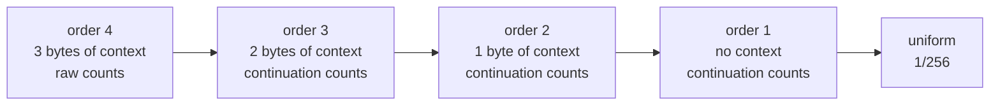
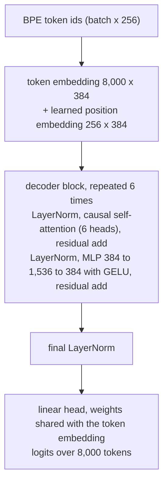

# kv-cache-nlp

Byte-level language modelling baselines for a study of patch-aware KV-cache compression.
CS F429 (Natural Language Processing), BITS Pilani, Hyderabad Campus. Group 12.

This repository holds Part 2 of our project. In it we built a data pipeline for two corpora of
very different difficulty (TinyStories and WikiText-103), trained two language models on both
from scratch (a byte-level Kneser-Ney 4-gram model and a 13.8M-parameter BPE Transformer),
measured both in bits per byte on exactly the same documents, analysed where each one succeeds
and fails, and wrapped it all in a command-line demo that trains a model live in front of the
examiner. The trained models and processed data are published as a GitHub Release, so the demo
runs on a fresh laptop without any training.

| Evaluation set (same documents for both models) | Kneser-Ney 4-gram | BPE Transformer | Reduction |
|---|---|---|---|
| TinyStories validation, first 500 documents | 1.8085 | **0.6939** | 61.6% |
| WikiText-103 validation, all 60 documents | 2.4103 | **1.5200** | 36.9% |
| WikiText-103 test, all 62 documents | 2.4381 | **1.5309** | 37.2% |

Bits per byte, lower is better; 8.0 means no compression at all. Every number in this table is
recomputed from the released files by demo option 4, or `python scripts/check_setup.py --full`.

This README is written for us, the five people presenting. Part A tells you exactly what to bring,
where every file goes and what to type on the day. Part B explains the whole project from the
very beginning, from what a cache is to every number in our report, so that any one of us can
explain any part of it. Part C is reference material.

## Contents

**Part A. Presenting the project**

1. [What you need on the day](#a1-what-you-need-on-the-day)
2. [Where every file goes](#a2-where-every-file-goes)
3. [The day before](#a3-the-day-before)
4. [On the day of the evaluation](#a4-on-the-day-of-the-evaluation)
5. [If something goes wrong](#a5-if-something-goes-wrong)
6. [The demo menu, option by option](#a6-the-demo-menu-option-by-option)

**Part B. The project, explained from the beginning**

1. [What a cache is](#b1-what-a-cache-is)
2. [How a language model writes text](#b2-how-a-language-model-writes-text)
3. [Attention: queries, keys and values](#b3-attention-queries-keys-and-values)
4. [The KV cache](#b4-the-kv-cache)
5. [Why the KV cache is a problem, and what others have tried](#b5-why-the-kv-cache-is-a-problem-and-what-others-have-tried)
6. [Tokens and bytes](#b6-tokens-and-bytes)
7. [The Byte Latent Transformer and entropy](#b7-the-byte-latent-transformer-and-entropy)
8. [Our idea](#b8-our-idea)
9. [What Part 2 had to deliver](#b9-what-part-2-had-to-deliver)
10. [The data](#b10-the-data)
11. [Preprocessing](#b11-preprocessing)
12. [The classical baseline: a Kneser-Ney byte 4-gram](#b12-the-classical-baseline-a-kneser-ney-byte-4-gram)
13. [The modern baseline: a BPE Transformer](#b13-the-modern-baseline-a-bpe-transformer)
14. [How we measure: bits per byte](#b14-how-we-measure-bits-per-byte)
15. [Results](#b15-results)
16. [Error analysis](#b16-error-analysis)
17. [Limitations](#b17-limitations)
18. [Every step we took, and what each one taught us](#b18-every-step-we-took-and-what-each-one-taught-us)
19. [Next: Part 3](#b19-next-part-3)

**Part C. Reference**

1. [Setting up by hand](#c1-setting-up-by-hand)
2. [What the release contains](#c2-what-the-release-contains)
3. [Repository map](#c3-repository-map)
4. [Reproducing every number from scratch](#c4-reproducing-every-number-from-scratch)
5. [Troubleshooting](#c5-troubleshooting)

---

# Part A. Presenting the project

The rules of the evaluation shape everything in this part. We upload our code to LMS without any
data files and our report as a PDF. At the evaluation we are asked to download our code from LMS
and run it, and the rubric requires that training is shown live and that results are shown
through a GUI or CLI. Our code therefore arrives on the laptop without its trained models and
datasets, and the first job of the demo is to put them back. Everything below is arranged so that
this happens in seconds and without internet on the day itself.

## A1. What you need on the day

Bring all of this:

1. **The laptop you will present from**, charged, with its charger. Windows 10 or 11, Linux or
   macOS all work. 8 GB of memory is enough. An NVIDIA GPU is welcome but not required: without
   one, show the n-gram training live and skip Transformer training (see A6).
2. **Python and PyTorch already installed on that laptop.** They cannot be installed without
   internet. Running `.\run.bat` (Windows) or `bash run.sh` (Linux, macOS) once the day before
   installs whatever is missing; see A3. If PyTorch has to be installed, keep about 5 GB of free
   disk space for it (the GPU build of PyTorch alone is about 2.6 GB).
3. **A USB drive holding two files**:
   - `kv-cache-nlp-part2-assets.zip` (138 MB): the trained models and the data. This is the one
     file the demo cannot work without. It is on the
     [release page](https://github.com/cfcmadlad/kv-cache-nlp/releases/tag/v0.2-part2).
   - `Group12_CSF429_Part2_code.zip` (about 0.5 MB): the same code we uploaded to LMS, in case
     LMS cannot be reached in the room.
4. **Your LMS login**, because we will be asked to download our own code from LMS.
5. **Our report PDF**, `Group12_CSF429_Part2_Report.pdf`, open on the laptop so you can point at
   its tables and figures.
6. **A web browser**, for the BPB Explorer page (`docs\bpb_explorer.html`), which works offline.
7. **This README and `REVIEW_GUIDE.md`.** The review guide lists the questions an examiner is
   most likely to ask about each file, with the answers, and who in the group explains what.

## A2. Where every file goes

When you unzip our code with Windows "Extract All", Windows creates a folder named after the zip
and puts our `kv-cache-nlp` folder inside it. The demo looks for the asset zip in the
`kv-cache-nlp` folder itself, in the two folders above it, and in your Downloads folder, so either
of the two marked places below works:

```
Downloads\                                   your normal Downloads folder
├── kv-cache-nlp-part2-assets.zip            <- PUT THE ASSET ZIP HERE (place 1)
├── Group12_CSF429_Part2_code.zip            the code zip from LMS
└── Group12_CSF429_Part2_code\               made by "Extract All"
    └── kv-cache-nlp\                        <- OPEN THE TERMINAL IN THIS FOLDER
        ├── run.bat                          the one command for Windows
        ├── run.sh                           the one command for Linux and macOS
        ├── kv-cache-nlp-part2-assets.zip    <- or put the asset zip here (place 2)
        ├── README.md, REVIEW_GUIDE.md
        ├── requirements.txt
        ├── docs\bpb_explorer.html           the visual explorer; double-click to open
        ├── eval\                            our committed result reports
        ├── models\                          the two model definitions
        ├── scripts\                         everything that runs
        ├── checkpoints\                     filled automatically: trained models
        └── data\processed\                  filled automatically: datasets
```

You never copy anything into `checkpoints\` or `data\processed\` by hand. The demo fills them
from the asset zip the first time it runs in a new folder, and checks the zip's fingerprint
(its SHA-256) before it unpacks a single byte.

If PyTorch is not already installed for your Python, `run.bat` creates one Python environment in
`%LOCALAPPDATA%\kv-cache-nlp\venv` (on Linux and macOS, `~/.cache/kv-cache-nlp/venv`) and installs
it there. That folder is deliberately outside the code folder, so every fresh copy of the code,
including the one you download from LMS on the day, reuses it instead of installing again.

**How to open a terminal in the `kv-cache-nlp` folder:**

- **Windows 11**: open the folder in File Explorer, right-click an empty area inside it, and
  choose "Open in Terminal".
- **Windows 10 or 11**: open the folder in File Explorer, click the address bar at the top, type
  `powershell` and press Enter. A PowerShell window opens in that folder.
- **macOS**: open Terminal, type `cd ` (with a space), drag the `kv-cache-nlp` folder onto the
  window, and press Enter.
- **Linux**: right-click inside the folder and choose "Open in Terminal".

In PowerShell you must type `.\run.bat`, with the dot and backslash in front; plain `run.bat`
gives a "not recognized" error. In the older Command Prompt both forms work. You can also simply
double-click `run.bat` in File Explorer.

## A3. The day before

Do this on the laptop you will present from, with internet, at least one day early. It takes 10
to 30 minutes, mostly for installing PyTorch if it is not there yet.

1. **Get the code exactly as the examiner will.** Log in to LMS, download our code zip
   (`Group12_CSF429_Part2_code.zip`) into your Downloads folder, right-click it, choose
   "Extract All", and accept the suggested location. You now have
   `Downloads\Group12_CSF429_Part2_code\kv-cache-nlp\`.
2. **Get the asset zip.** Open the
   [release page](https://github.com/cfcmadlad/kv-cache-nlp/releases/tag/v0.2-part2) and download
   `kv-cache-nlp-part2-assets.zip` (138 MB) into the same Downloads folder (place 1 in A2). Do not
   rename it. Then copy both zips onto your USB drive.
3. **Run the one command.** Open a terminal in the `kv-cache-nlp` folder (see A2) and type
   `.\run.bat` on Windows or `bash run.sh` on Linux and macOS. It will:
   1. find Python 3.10 or newer, and install Python 3.12 if there is none (with `winget` on
      Windows, Homebrew on macOS, `apt` on Debian or Ubuntu);
   2. use that Python directly if it already has PyTorch, and otherwise create the shared
      environment described in A2 and install PyTorch into it (the GPU build if the laptop has an
      NVIDIA GPU, the CPU build otherwise) together with the small packages in `requirements.txt`;
   3. start the demo, which notices that the models and data are missing, finds the asset zip in
      your Downloads folder, verifies it and unpacks it into `checkpoints\` and `data\processed\`.

   When the menu appears, type `4` and press Enter: it re-scores the evaluation sets and should
   end with `PASS`. Then type `5` to quit.
4. **Rehearse the whole thing once.** Delete the extracted `Group12_CSF429_Part2_code` folder,
   extract the zip again, open a terminal in the new `kv-cache-nlp` folder and run the command
   again. This time it should reach the menu within about 20 seconds, with no internet needed.
   Walk through options 1 to 4 exactly as in A4. This rehearsal is what the 14th will look like.
5. **If Python had to be installed** in step 3, Windows may ask you to close the terminal, open a
   new one and run `.\run.bat` once more. That is expected.
6. **If an antivirus interrupts the installation** (Norton stopped it on one of our laptops), open
   the antivirus's history, allow the blocked item, and run the command again. See A5.

## A4. On the day of the evaluation

This is the full script. Each step says what to do and what to say.

1. **Download our code from LMS** as the examiner asks, into Downloads, and "Extract All".
   Say: "This is exactly the code we submitted. It contains no data, as the instructions required;
   the trained models and datasets come from our public GitHub release, and we brought a copy."
2. **Make sure `kv-cache-nlp-part2-assets.zip` is in Downloads** (place 1) or inside the new
   `kv-cache-nlp` folder (place 2). If it is only on the USB drive, copy it to one of those places.
3. **Open a terminal in the new `kv-cache-nlp` folder and run `.\run.bat`** (or `bash run.sh`).
   Everything installed the day before is reused. The demo prints `First run: the trained models
   and data are not here yet`, then `Using the local copy ...`, then `SHA-256 verified.`, and the
   menu appears. This takes about 10 to 20 seconds and needs no internet.
   Say: "The script checked Python and PyTorch, found our trained models next to the code,
   verified their checksum and unpacked them."
4. **Show training live: type `1`, then `tinystories`, then `ngram`.** About 10 seconds. You see
   it count byte n-grams on 3,000 stories, fit one discount per order, and print a validation BPB
   of about 1.83. On a laptop with an NVIDIA GPU, run it once more with `transformer` instead:
   about 100 seconds, with the validation loss printed every 50 of its 300 steps (it falls from
   about 7.7 to about 3.5) and a final BPB of about 1.39. While it trains, open
   `docs\bpb_explorer.html` in the browser and show how each model's cost varies along real text.
   Say: "This runs our real training script on a small subset, so you see genuine training. The
   full-scale runs took 13 and 10 minutes on a GPU, so we load those for the results."
5. **Show the results: type `2`.** The comparison table of the full-scale models appears.
   Point at `val_bpb`: 0.6939 against 1.8477 on TinyStories and 1.52 against 2.4103 on
   WikiText-103. Point at `val_docs`: each training script scored its own validation slice, and the
   matched comparison (1.8085 against 0.6939, same 500 documents) is in our report's Table 3.
6. **Show the models working: type `3`**, choose a dataset and a model, and type a full sentence,
   for example `The little dog was happy because it found a bone.` The demo prints its bits per
   byte and continues the text. Compare the n-gram (garbled word fragments) with the Transformer
   (fluent sentences). Press Enter on an empty line to return to the menu. Use full sentences, not
   three-word phrases (see A6).
7. **Prove the numbers: type `4`.** It loads the four trained models, re-scores 500 TinyStories
   and 122 WikiText-103 documents from scratch, prints each of the six results next to the
   reported value, and ends with `PASS`. Under a minute on a GPU, about two on a CPU.
   Say: "These are recomputed now, from the weights, on this laptop."
8. **Type `5` to quit.** Answer questions with the help of `REVIEW_GUIDE.md` and Part B below.

## A5. If something goes wrong

| What you see | What to do |
|---|---|
| No internet in the room | Nothing changes, as long as A3 was done on this laptop and the asset zip is in Downloads or in the `kv-cache-nlp` folder. The demo then never touches the network. |
| LMS cannot be reached | Use `Group12_CSF429_Part2_code.zip` from the USB drive; it is the same code. |
| `run.bat` is "not recognized" | In PowerShell type `.\run.bat`, with the dot and backslash. Check that the terminal is inside the `kv-cache-nlp` folder (type `dir`; you should see `run.bat`). |
| The demo says it is downloading from GitHub, but there is no internet | The asset zip is not in a place the demo looks. Press Ctrl+C, copy the zip into Downloads or into the `kv-cache-nlp` folder, and run the command again. |
| `SHA-256 mismatch` | That copy of the asset zip is damaged or incomplete. Copy it again from the USB drive. With internet, the demo falls back to downloading a fresh copy on its own. |
| The installation stops halfway, or a file disappears | An antivirus can stop installers started from a script (Norton did this on our laptop). Open the antivirus history, allow the item and run the command again. If it keeps failing, delete `%LOCALAPPDATA%\kv-cache-nlp\venv` and retry, or follow C1. |
| `CUDA available: False` on a laptop with an NVIDIA GPU | The CPU build of PyTorch is installed. Everything still works; skip Transformer training in option 1 and use the n-gram. |
| Option 1 with `transformer` is very slow | Expected without a GPU: 300 steps take 25 to 30 minutes on a CPU. Press Ctrl+C and use `ngram` (about 10 seconds). Ctrl+C also closes the menu; run the command again to reopen it. |
| A window opens and closes instantly | Open a terminal in the folder and run `.\run.bat` there, so you can read the messages. |
| Option 4 ends with `FAIL` | Read the line above it; it names the file and the fix. It cannot fail on correct files, so it means the wrong or a damaged asset zip. |
| Garbled characters in the console | Cosmetic only. In Command Prompt, `chcp 65001` switches it to UTF-8. |

## A6. The demo menu, option by option

The menu is `scripts\demo.py`. Its five options:

**1) Train a model live.** Choose a dataset and a model. The demo runs our real training script in
a small configuration, so the examiner sees the same progress bars and loss log a full run prints:

- n-gram: order 4, the first 3,000 training documents, scored on 300 validation documents;
- transformer: a fresh 2,000-token BPE vocabulary learned from the first 3,000 training documents,
  then 300 optimizer steps with the validation loss printed every 50 steps.

Everything this option writes goes to `checkpoints\demo\`. It never touches the real checkpoints in
`checkpoints\`, so a live run cannot change the reported results. Measured run times:

| Choice | NVIDIA RTX 4060 Laptop GPU | CPU only |
|---|---|---|
| n-gram, TinyStories | 9 s | 9 s (the n-gram never uses the GPU) |
| n-gram, WikiText-103 | 147 s | about the same (3,000 WikiText documents are 51 MB of text to count) |
| transformer, TinyStories | 99 s | about 25 to 30 minutes (5 s per step), too slow to show live |
| transformer, WikiText-103 | 187 s | longer still |

The live runs reach a validation BPB of 1.829 (n-gram) and 1.390 (Transformer) on TinyStories,
worse than the full models (1.8477 and 0.6939) because they see a tenth of the data and a tenth of
the training steps. That difference is itself worth pointing out.

To show Transformer training on a laptop without a GPU anyway, run a shorter version of the same
command directly. The progress output is identical; this 60-step version took 6 minutes on our
laptop's CPU, and `--max-steps 20 --eval-interval 10` brings it to about 2 minutes:

```bash
python scripts/train_bpe_transformer.py --dataset tinystories --max-train-docs 3000 --eval-max-docs 300 --vocab-size 2000 --max-steps 60 --eval-interval 20 --out checkpoints/demo
```

**While option 1 runs, open the BPB Explorer.** Double-click `docs\bpb_explorer.html`; it needs no
server and works offline (only its web font falls back). Pick an evaluation set and a document,
including the hardest and easiest TinyStories documents. The text is coloured character by
character by the 4-gram's cost, the Transformer's cost, or the difference between them, which
shows where the Transformer saves bits. Hovering a character compares both models; a chart shows
the cost along the document with the Transformer's 256-token context restarts marked; a table
ranks the costliest words. These are the real per-byte outputs of the two released models.

**2) Show the comparison table.** Prints the results of the full-scale runs from
`checkpoints\*_results.json` and saves the same table to `eval\bpb_comparison.md`. Each training
script scored its own validation slice, which is why the TinyStories n-gram shows 1.8477 here
(2,000 documents) and 1.8085 in the matched table (the same 500 documents the Transformer was
scored on).

**3) Score a sentence and generate.** Pick a dataset and a model and type a sentence. The demo
prints its bits per byte under the full-scale model and samples a continuation (120 bytes for the
n-gram, 60 tokens at temperature 0.8 for the Transformer). Good contrasts: a TinyStories sentence
under the TinyStories and the WikiText models, or the same sentence under the n-gram and the
Transformer. Generations are random, so they differ between runs. Press Enter on an empty line to
return to the menu.

Type a full sentence, not two or three words. The Transformer never predicts the first token of
its input (B14 explains why), so on a very short phrase that free first token is a large share of
the bytes: "Once upon a time" scores an unrealistic 0.010 BPB under the TinyStories Transformer.
On a full sentence the effect is small, and on the evaluation sets it is under 0.6 percent.

**4) Verify the reported numbers.** Runs `scripts\check_setup.py --full`: loads the four released
models, re-scores the 500 TinyStories, 60 WikiText-103 validation and 62 test documents from
scratch, and compares the six results with the reported values to four decimals. It ends with
`PASS`. This is the quickest answer to "did you really run this?".

**5) Quit.**

---

# Part B. The project, explained from the beginning

## B1. What a cache is

Every computer is built from memories of different speeds and sizes. A processor can read its own
registers almost instantly, its small on-chip caches a little more slowly, main memory more slowly
still, and a disk or a network far more slowly than any of these. A cache is simply a small, fast
store that keeps the results of work already done, so that the next time the same result is
needed it is read rather than recomputed or fetched from far away. A web browser caches images it
has already downloaded; a processor caches the memory it has just touched. A cache always trades
memory for time: it spends space to save work. That trade is the whole subject of this project.

## B2. How a language model writes text

A language model reads a piece of text and assigns a probability to every possible next symbol.
Writing text is just this, repeated: the model predicts a distribution over the next symbol,
one symbol is chosen from it, appended to the text, and the model predicts again from the longer
text. Each new symbol is predicted from everything before it, which is why the work done for the
earlier symbols matters so much for the later ones.

The "symbols" can be whole words, fragments of words called tokens, or the raw bytes of the text.
Which one is chosen turns out to matter a great deal, and B6 returns to it.

## B3. Attention: queries, keys and values

A Transformer, the architecture behind modern language models, lets every position in a text look
at every earlier position through a mechanism called attention. At each layer, every position
produces three vectors from its current representation:

- a **query**, which says what this position is looking for;
- a **key**, which says what this position offers to others;
- a **value**, which is the information this position hands over if it is looked at.

To update position t, the model compares t's query with the keys of every position up to t, turns
those similarity scores into weights that sum to one (a softmax), and takes the weighted sum of
the corresponding values. Positions after t are hidden from it by a causal mask, because when
predicting the future the model must not see it. In our Transformer each position's
representation has 384 numbers, split across 6 attention heads of 64 numbers each, and this
happens in each of 6 layers (`CausalSelfAttention` in `models/transformer.py`).

## B4. The KV cache

Now consider writing text one symbol at a time. When the model adds the 1,000th symbol, the keys
and values of the first 999 symbols are exactly the same as they were when the 999th symbol was
added: earlier positions never look forward, so nothing later can change them. Recomputing them at
every step would be pure waste. So every practical system stores them, layer by layer, the moment
they are computed, and at each new step computes the key and value of only the newest symbol and
reads all the others from the store. That store is the **key-value cache**, or **KV cache**. It
turns the cost of producing each new symbol from "recompute the whole text" into "compute one
position and read the rest".

The price is memory, and it grows with every symbol. For each symbol the cache holds one key and
one value in every layer:

> KV cache size = 2 (key and value) × number of layers × model width × number of symbols × bytes per number

For our own Transformer that is 2 × 6 × 384 = 4,608 numbers per token, which at 4 bytes per number
is 18,432 bytes (18 KB) per token, and for a full 256-token window 1.18 million numbers or about
4.7 MB. That is tiny, because our model is tiny. For a widely used model such as Llama 2 7B (32
layers of width 4,096, numbers stored in 2 bytes) the same formula gives half a megabyte per token,
so a single 4,096-token conversation needs about 2 GB of cache, and that is per user. On a server
holding one model for many users, the KV cache, not the model, is what limits how many people can
be served at once and how long their texts can be.

Our demo's `GPT.generate` deliberately does not keep a KV cache; it recomputes the full forward
pass over up to 256 tokens for each new token. That keeps the code short and easy to read, and
Part 3 is where the cache itself becomes the object of study.

## B5. Why the KV cache is a problem, and what others have tried

Because the cache grows without limit as a text gets longer, systems that must handle long texts
have to decide what to keep. Three well-known approaches:

- **StreamingLLM** (Xiao et al., 2023) keeps the first few tokens of the text, which turn out to
  receive a great deal of attention regardless of their content ("attention sinks"), plus a sliding
  window of the most recent tokens, and evicts everything in between.
- **H2O** (Zhang et al., 2023) keeps the "heavy hitters": the tokens that have accumulated the most
  attention so far, plus recent ones.
- **KVQuant** (Hooper et al., 2024) keeps everything but stores each number with far fewer bits.

All of them decide by recency, by attention, or by numerical range. None of them asks how
surprising the text was to the model at each position, and that is the question our project asks.

## B6. Tokens and bytes

Most language models do not read characters or bytes. They first split text into **tokens** with
byte-pair encoding (BPE): starting from single characters or bytes, the most frequent adjacent
pair in a large text is merged into a new symbol, again and again, until a vocabulary of the chosen
size exists. Our Transformer uses a byte-level BPE vocabulary of 8,000 tokens, learned separately on
each of our two corpora. Common words become single tokens, rare words are spelled out in pieces.

Tokenizers have well-known costs: a fixed vocabulary chosen in advance, awkward behaviour on
misspellings, rare names and numbers, and a vocabulary that favours the languages and domains it
was learned on. **Byte-level models** avoid all of this by reading the raw UTF-8 bytes of the text:
there are only 256 possible bytes, so every text in every language is representable, and nothing is
ever unknown.

The price is length. In our own data one BPE token covers 4.08 bytes of TinyStories and 3.91 bytes
of WikiText-103, so a byte-level model must process about four times as many positions for the
same text, and by B4 its KV cache is about four times larger too. Byte-level models pay for their
simplicity in exactly the currency that B4 and B5 describe.

## B7. The Byte Latent Transformer and entropy

The Byte Latent Transformer (BLT; Pagnoni et al., 2024) is Meta's answer to the length problem. A
small byte-level model reads the text and, at every byte, computes the **entropy** of its
prediction for the next byte: H = −Σ p(b) log₂ p(b), summed over the 256 possible bytes. Entropy is
low when the model is confident (the rest of a common word, a space after a full stop) and high
when it is unsure (the first letter of a name, a digit, the start of a new idea). BLT starts a new
**patch** wherever the entropy is high and groups the predictable bytes in between into the same
patch. A small local encoder turns each patch into one vector, a large global Transformer works on
patches rather than bytes, and a small local decoder turns its output back into bytes. Hard regions
get many short patches and therefore much computation; easy regions get few long ones. BLT computes
the entropy of every byte, uses it to place patch boundaries, and then throws it away.

## B8. Our idea

Our Part 1 proposal was to keep those entropies and use them to manage the KV cache. A position
the model found easy to predict (low entropy) carried little information the model did not already
have; a position that surprised it (high entropy) is exactly where something new entered the text,
such as a name, a number or a new topic. Our hypothesis is that entries for low-entropy positions
can be compressed or evicted with little loss, while high-entropy ones must be kept in full. In
Part 3 we will build a BLT-style model with an entropy patcher, compress its cache by entropy, and
compare that policy with StreamingLLM-style recency eviction and with random eviction at the same
memory budget. Part 2, this repository, builds everything that comparison stands on.

Part 2 already contains evidence for the hypothesis. In B16 we show that when a rare word appears a
second time in a document, the Transformer, which can look back at the first mention, pays 18 to 19
percent fewer bits for it, while the 4-gram, which cannot, pays the same. That saving comes from
attention reaching back into exactly the kind of entry an entropy-guided cache would keep, and a
recency-based one might already have thrown away.

## B9. What Part 2 had to deliver

The course asks Part 2 for at least one baseline model, a report with sections on the introduction,
literature, dataset and method, a demonstration in which training is shown live, and results shown
through a GUI or CLI. The rubric gives marks for the literature survey, for the dataset and its
preprocessing (with statistics and examples of the effect), for the metrics, for model details,
hyperparameters, preliminary results and error analysis, and the largest share for the
demonstration and viva. We delivered two baselines rather than one, a classical model and a modern
one, because the course asks us to compare a classical method with a modern approach and show how
the field has evolved, and because Part 3 needs both as reference points.

## B10. The data

We chose two corpora as different from each other as our compute budget allowed, so that a model
which only works on easy text would show itself immediately.

**TinyStories** (`roneneldan/TinyStories` on HuggingFace; Eldan and Li, 2023) is a collection of
short children's stories written by GPT-3.5 and GPT-4 with a deliberately small vocabulary. The same
few characters, objects and lessons return again and again ("Once upon a time, there was a little
girl named Lily..."), and most stories are shorter than a page. We use its first 30,000 training
stories and its whole validation split of 21,990 stories, and we evaluate on the first 500 of those.
It downloads and trains in minutes, and because the text is so regular a broken pipeline shows up at
once; we used it to validate every stage before trusting anything on the harder corpus.

**WikiText-103** (`Salesforce/wikitext`, configuration `wikitext-103-raw-v1`; Merity et al., 2016) is
its opposite: Good and Featured articles from English Wikipedia, long, factual and full of dates,
numbers and foreign names. We use every article in all three splits: 29,002 for training, 60 for
validation and 62 for test.

| | TinyStories | WikiText-103 |
|---|---|---|
| Domain | synthetic children's stories | encyclopedic articles |
| Training documents | 30,000 | 29,002 |
| Training bytes | 26,689,484 (26.7 MB) | 526,441,169 (526.4 MB) |
| Validation / test documents | 21,990 / none | 60 / 62 |
| Bytes scored in evaluation | 405,231 (500 docs) | 1,129,194 (val); 1,269,744 (test) |
| Mean / median document length | 890 / 783 bytes | 18,152 / 13,442 bytes |
| 5th to 95th percentile of length | 524 to 1,748 bytes | 3,906 to 48,700 bytes |
| Longest document | 4,540 bytes | 143,885 bytes |
| Distinct byte values used | 105 | 204 |
| Training documents with any non-ASCII byte | 1,642 (5.5%) | 26,716 (92.1%) |
| Space before punctuation, per 1,000 bytes | 0.0 | 17.0 |
| Distinct word forms (training) | 13,228 | 594,013 |
| Word tokens (training) | 5.22 million | 82.05 million |
| Validation words never seen in training | 0.13% | 0.54% |
| Bytes per BPE token (8,000-token vocabulary) | 4.08 | 3.91 |
| Exact duplicates removed (training split) | 0 | 442 |

Word statistics use lower-cased, whitespace-separated words. Articles are about seventeen times
longer than stories at the median. Byte for byte the two corpora look surprisingly alike:
lower-case letters are 73.1% of TinyStories and 73.0% of WikiText-103, spaces 19.1% and 18.4%,
upper-case letters 2.8% and 3.5%. They differ most in digits (0.003% against 1.6%), in vocabulary,
and in non-English characters. WikiText-103 also keeps the punctuation style of its original
tokenizer, with a space before a punctuation mark 17 times per 1,000 bytes (`word , word`); those
spaces are easy to predict and lower its BPB, which is one reason BPB values cannot be compared
directly across the two corpora.

Our Part 1 plan listed four datasets. Two are kept for Part 3: The Stack Smol (source code) for a
code-versus-prose comparison and PG-19 (books from Project Gutenberg) for long-context tests.
WikiText-103, planned in Part 1 only for evaluation, is now also used to train its own models.
Larger corpora such as C4 and OpenWebText were too big for our compute budget.

**Limitations of the data.** TinyStories is synthetic, narrow and English only, so it is a sanity
check rather than a picture of natural text. WikiText-103 is a 2016 snapshot of highly rated English
Wikipedia articles, formal and shaped by what its editors chose to write. The evaluation sets are
very unequal in size (21,990 validation stories against 60 and 62 articles). Duplicates are removed
only within a split, and we did not check for near-duplicates, for overlap between training and
test data, or for transfer between the two corpora.

## B11. Preprocessing

All of this happens in `scripts/prepare_data.py`.

1. **Rebuilding WikiText articles.** The "raw" WikiText export is not one article per row. It is a
   stream of lines, with a line like `= Homarus gammarus =` marking where an article begins. In the
   validation split there are 3,760 rows, of which 1,299 are empty and 60 are article titles. We
   start a new document at every top-level title (a single `=` on each side; section headings such
   as `= = History = =` stay inside their article), join each article's non-empty lines with
   newlines, and drop any title with no text under it.
2. **Removing placeholders.** An older extraction tool replaced some hyphens, commas and decimal
   points inside words and numbers with ` @-@ `, ` @,@ ` and ` @.@ `. Left in, both models would
   learn to predict an artefact of someone else's software, so we restore the real character: in
   the first validation article, "red @-@ tipped" becomes "red-tipped" and "0 @.@ 7" becomes "0.7".
   The validation split alone contains 1,864 `@-@`, 391 `@,@` and 263 `@.@`.
3. **Unicode NFC normalisation and trimming**, so that visually identical text is also
   byte-identical. On the first 30,000 TinyStories rows this changed nothing.
4. **Exact deduplication** within each split, by SHA-256 hash of the normalised text. It removed 442
   WikiText training articles and nothing anywhere else.
5. **Writing** one JSON object per line, `{"id": "wikitext103-train-0", "text": "..."}`, to
   `data/processed/<dataset>/<split>.jsonl`, plus a `stats.json` per corpus with document and byte
   counts.

We deliberately do **not** apply stemming, lemmatisation, stop-word removal, lower-casing or word
tokenisation, because the task is to predict the exact text; any of those would change what is
being predicted and make bits per byte meaningless. As a check, the Transformer's byte-level BPE
tokenizer turns 200 of 200 TinyStories and 60 of 60 WikiText-103 validation documents back into
exactly the original text. Rebuilding the data from scratch with the commands in C4 reproduces all
seven processed files byte for byte; we checked.

## B12. The classical baseline: a Kneser-Ney byte 4-gram

The classical model (`KneserNeyByteLM` in `models/ngram.py`, trained by `scripts/train_ngram.py`)
predicts each byte from the three bytes before it. Its vocabulary is the 256 byte values, so it
needs no tokenizer and never meets an unknown symbol. Each document is padded on the left with a
start symbol (`-1`, outside the byte range), so counts never cross from one document into the next.

Counting alone would give zero probability to any 4-byte sequence never seen in training, so the
counts must be smoothed. We use interpolated Kneser-Ney (Kneser and Ney, 1995, in the interpolated
form that Chen and Goodman, 1999, found among the strongest classical methods). Every order uses
the same formula:

```
P(b | context) = max(c(context, b) - D, 0) / c(context) + D * N(context) / c(context) * P_lower(b | shorter context)
```

Here `c` is a count, `N(context)` is the number of different bytes ever seen after that context,
`D` is the order's discount, and the shorter context drops the oldest byte. In words: trust what
was seen after the longest context, but hold back a share of the probability and pass it down to
the next shorter context. The chain ends in a uniform 1/256, so no byte ever gets zero probability.



What makes it Kneser-Ney rather than plain absolute discounting is that only the top order uses raw
counts. Every lower order uses **continuation counts**: how many different longer contexts a byte
has been seen after, not how often it occurred. A byte that is frequent only inside one fixed
pattern then gets little weight when the model has to back off, which is exactly when that pattern
is absent. The **discounts** are fitted from the data for each order as `D = n1 / (n1 + 2 * n2)`
(Ney, Essen and Kneser 1994), where `n1` and `n2` count the (context, byte) pairs whose count in that
order's table (raw or continuation) is exactly 1 and exactly 2, and are clamped to [0.1, 0.9]. The
fitted values are 0.7059, 0.5935, 0.5528, 0.5451 for TinyStories (orders 1 to 4) and
0.3617, 0.5699, 0.6561, 0.5618 for WikiText-103. Our Part 1 plan named modified Kneser-Ney, which uses three
discounts per order; we implemented the simpler interpolated form with one.

The model is written in pure Python and runs on the CPU. Exact counting slows down with the number of
bytes, not documents, so we measured before choosing (1,000 WikiText articles took 38.5 seconds to
count) and trained on the first 25,000 stories (22.3 MB, 39.4 seconds) and the first 4,500 articles
(78.3 MB, about 15% of the training set, 149.5 seconds). WikiText gets fewer documents but more
bytes. The fitted models store 68,188 distinct n-grams for TinyStories (104, 1,786, 12,515 and
53,783 for orders 1 to 4) and 448,649 for WikiText-103 (201, 9,085, 73,881 and 365,482), in pickle
files of 0.6 MB and 3.8 MB.

## B13. The modern baseline: a BPE Transformer

The modern model (`GPT` in `models/transformer.py`, trained by `scripts/train_bpe_transformer.py`)
is intentionally the conventional design any course would expect: a small GPT-2-style decoder over
BPE tokens. We give it tokens rather than bytes on purpose; the byte-level model is the subject of
Part 3, and this one should be the standard against which it is measured.



- **Tokenizer.** Byte-level BPE (HuggingFace `tokenizers`) with an 8,000-token vocabulary, trained
  separately on each corpus's full training split, with `<|endoftext|>` as the only special token.
  Byte-level BPE is lossless: decoding the tokens of a text gives back exactly that text, which bits
  per byte relies on.
- **Architecture.** 6 layers, 6 attention heads of width 64, model width 384, MLP width 1,536,
  context of 256 tokens (about 1,000 bytes), dropout 0.1, learned position embeddings, pre-LayerNorm
  blocks and a final LayerNorm. Attention calls `torch.nn.functional.scaled_dot_product_attention`
  with `is_causal=True`, which applies the causal mask and uses a fused kernel where available.
- **Weight tying.** The output layer reuses the token-embedding matrix (Press and Wolf, 2017), saving
  3.07M parameters.
- **Initialisation.** All weight matrices, the embeddings included, start from a normal distribution
  with standard deviation 0.02, and biases start at zero, as in GPT-2. PyTorch's default embedding
  initialisation (standard deviation 1.0) made the initial logits, computed through the tied head,
  far too large. With 0.02 the first logged validation loss is about 9.0 nats, close to a uniform
  guess over 8,000 tokens (ln 8,000 = 8.99), exactly as it should be for an untrained model.
- **Parameters: 13,817,856**, all trained from scratch; no pre-trained checkpoint is used. Token
  embedding 3,072,000; position embedding 98,304; six blocks of 1,774,464 each (attention 591,360,
  MLP 1,181,568, two LayerNorms 1,536); final LayerNorm 768. The head adds nothing because it is
  tied.

Training joins every training document into one long token stream, with `<|endoftext|>` between
documents, and draws random 256-token windows from it. Settings for both reported runs:

| Setting | Value |
|---|---|
| Optimizer | AdamW, learning rate 3e-4, betas (0.9, 0.999), epsilon 1e-8, weight decay 0.01 on all parameters |
| Learning-rate schedule | linear warm-up over 100 steps, then constant |
| Batch | 32 windows of 256 tokens (8,192 tokens per step) |
| Steps | 3,000 (24.6M tokens in total) |
| Gradient clipping | none (`--grad-clip 0`, see below) |
| Seed | 0 |
| Hardware and software | NVIDIA RTX 4060 Laptop GPU (8 GB), Python 3.13.7, PyTorch 2.9.0, tokenizers 0.23.2, datasets 5.0.1 |
| Training time | 780.9 s (TinyStories), 586.0 s (WikiText-103) |

The 24.6M training tokens cover TinyStories (6.54M tokens) 3.76 times, and only 0.18 of a pass over
WikiText-103 (134.8M tokens). No hyperparameter was tuned. The validation loss fell at every logged
point. On TinyStories (rerun with the same seed and settings) it went from 9.05 nats at step 0 to
3.97 at step 200, 2.66 at 1,000, 2.21 at 2,000 and 2.03 at step 2,999; on WikiText-103 from 9.03 to
6.25 at step 200, 5.06 at 1,000, 4.52 at 2,000 and 4.18 at step 2,999. Both curves were still falling
when training stopped. On 50 random validation batches the final cross-entropy per token was 2.0406
nats on TinyStories (perplexity 7.70) and 4.2008 on WikiText-103 (perplexity 66.7); these numbers
only make sense within one tokenizer, which is why our main metric is bits per byte.

**Gradient clipping.** The two reported checkpoints were trained before gradient clipping was added to
the script. The `--grad-clip` flag now defaults to 1.0 for new runs, and `--grad-clip 0` reproduces
the reported runs: a TinyStories rerun with `--grad-clip 0` gives validation BPB 0.6939 again,
identical to four decimals. With clipping at 1.0 the same run gives 0.6826, 1.6% lower, with a
final validation loss of 2.00 instead of 2.03. We report the unclipped models because they are the
ones that were evaluated in full.

## B14. How we measure: bits per byte

Both models are scored in **bits per byte (BPB)**: the total number of bits the model needs to
encode a set of documents, which is `-log2 P(text)` summed over every prediction, divided by the
total number of UTF-8 bytes in those documents.

```
BPB = - (sum over documents, sum over predicted units of log2 p(unit | everything before it)) / (sum over documents of their length in bytes)
```

The units are bytes for the 4-gram and BPE tokens for the Transformer, but the denominator is always
bytes, so both models are measured on the same scale. Perplexity and per-token cross-entropy cannot
do this, because they depend on what a "token" is. Bits per byte also has a concrete meaning:
Shannon's source coding theorem, and Delétang et al. (2024) for language models specifically, show
that an arithmetic coder driven by the model would compress the text to exactly this many bits per
byte. Storing text without any model costs 8.0. It is also the metric BLT reports, which keeps Part 2
and Part 3 comparable. Its limits: it measures how well a model predicts text, not whether generated
text is true or well written; it depends on how the text is formatted; and it is noisy on sets of
only 60 and 62 articles.

- **4-gram** (`KneserNeyByteLM.bits_per_byte`): one prediction per byte, so the bits are summed over
  every byte of every document and divided by the total byte count. Probabilities are floored at
  1e-12 so a log of zero is impossible; the smoothing never actually produces a zero.
- **Transformer** (`bits_per_byte` in `scripts/train_bpe_transformer.py`): per-token cross-entropy in
  nats, converted to bits, summed, and divided by the total byte count.

**Whole documents, in chunks.** The Transformer sees at most 256 tokens, but WikiText articles run to
thousands. Truncating them would score less text than the 4-gram scores. `_doc_chunks` therefore
splits every document into consecutive, non-overlapping 256-token chunks and records, for each chunk,
the exact number of bytes of original text it covers. Those byte counts come from cutting the
original text at the tokenizer's character offsets, not from decoding tokens: byte-level BPE merges
do not always end on character boundaries, so decoding a cut-off token sequence can split a
multi-byte character and miscount. `_score_chunks` then scores 32 chunks per forward pass, padding
them to a common length and masking the padding out of the loss; scoring one chunk at a time was far
too slow on WikiText.

**One known, small bias.** The first token of each chunk is input only and is never predicted, so its
bits are not counted while its bytes are. Two things cause it: scoring encodes each document on its
own, without the `<|endoftext|>` separator that preceded it during training, so a document's first
token has nothing to be predicted from; and chunks do not overlap, so each later chunk starts with no
context either. One token per chunk goes unscored: about 1 in 256 on WikiText-103, where nearly every
chunk is full, and about 1 in 200 on TinyStories, where a story is usually a single chunk. These
tokens hold 0.373% (WikiText validation), 0.396% (WikiText test) and 0.547% (TinyStories) of the
bytes, which is how much the byte count alone lowers the reported BPB. The true gap to predicting
every byte is probably a little larger, because these tokens have the least context and would cost
more than an average token to predict. Either way it is far below the gap of more than 35 percent
between the models, so no conclusion depends on it. Our report therefore also gives a "corrected"
value that counts only the predicted bytes (B15). The fix, prepending `<|endoftext|>` to each
document and scoring with overlapping windows, changes the reported numbers, so it is planned for
Part 3, where the byte-level model will predict every byte.

**Matched documents.** Each training script reports BPB on its own validation slice, set by
`--eval-max-docs`. The main comparison therefore scores both models on exactly the same documents;
demo option 4 and `check_setup.py --full` recompute it. No setting was ever chosen using these
documents, and the test set was never used to choose anything.

## B15. Results

**On identical documents** (recomputed by demo option 4):

| Evaluation set | Documents | Bytes | Kneser-Ney 4-gram | BPE Transformer | Transformer, corrected | Change |
|---|---|---|---|---|---|---|
| TinyStories validation | first 500 | 405,231 | 1.8085 | 0.6939 | 0.6978 | -61.6% |
| WikiText-103 validation | all 60 | 1,129,194 | 2.4103 | 1.5200 | 1.5257 | -36.9% |
| WikiText-103 test | all 62 | 1,269,744 | 2.4381 | 1.5309 | 1.5370 | -37.2% |

"Corrected" counts only the bytes the Transformer actually predicts (B14). The 95% confidence
intervals, from 2,000 bootstrap resamples of whole documents, are [1.8028, 1.8283] for the 4-gram and
[0.6831, 0.7128] for the Transformer on TinyStories, [2.3741, 2.4445] and [1.4831, 1.5688] on
WikiText-103 validation, and [2.4067, 2.4778] and [1.4917, 1.5804] on test. The interval of the
difference (4-gram minus Transformer) is [1.109, 1.126], [0.865, 0.903] and [0.874, 0.932], far from
zero in every case. The Transformer is better on every one of the 622 documents.

**Against ordinary compressors.** As untrained reference points we compressed each document alone,
and each whole set at once, with gzip (level 9), bzip2 (-9) and xz (preset 9). Compressing documents
one at a time, the best of the three needs 4.0246 bits per byte on TinyStories (gzip), 2.7354 on
WikiText-103 validation and 2.6587 on test (bzip2); the 4-gram beats the best of them on all three
sets, and on 610 of the 622 documents individually. Given a whole WikiText-103 set at once, xz does
slightly better than the 4-gram (2.3495 and 2.3123 against 2.4103 and 2.4381), because it can reuse
long repeats across 60 articles while the 4-gram sees three bytes back. On TinyStories, xz on the
whole set reaches 1.9360, still behind the 4-gram's 1.8085. The 4-gram is therefore a reasonable
baseline, and the Transformer is far ahead of everything.

**Values written by the training scripts** (`checkpoints/*_results.json`, shown by demo option 2):

| Dataset | Model | Training data | Validation BPB (documents) | Training BPB, 200-doc sample | Training time |
|---|---|---|---|---|---|
| TinyStories | n-gram, order 4 | 25,000 docs | 1.8477 (first 2,000) | 1.8775 | 39 s |
| TinyStories | Transformer, 13.8M | 30,000 docs, 3,000 steps | 0.6939 (first 500) | 0.7745 | 781 s |
| WikiText-103 | n-gram, order 4 | 4,500 docs | 2.4103 (all 60) | 2.3993 | 150 s |
| WikiText-103 | Transformer, 13.8M | 29,002 docs, 3,000 steps | 1.5200 (all 60) | 1.5459 | 586 s |

Training and validation BPB are close for both models, so neither overfits. The TinyStories
Transformer even scores better on validation than on its training sample (0.6939 against 0.7745),
which reflects the particular 200 training documents in the sample rather than a problem.

## B16. Error analysis

Numbers here come from our report's analysis of the 500 TinyStories and 122 WikiText-103 evaluation
documents, and from `scripts/error_analysis.py`, whose output for 300 TinyStories and 60 WikiText-103
validation documents is committed in `eval/`.

**The two models find the same documents hard.** The per-document BPB of the two models is strongly
correlated: Pearson r = 0.75 on the 500 TinyStories documents, 0.73 on WikiText-103 validation and
0.74 on test (Spearman 0.70, 0.74 and 0.71). On the 300 TinyStories and 60 WikiText-103 documents of
`eval/error_analysis_*.md` the Pearson values are 0.74 and 0.73. Difficulty is mostly a property of
the text, not of the model. Both models find hardest the stories built around unusual names, such as
an octopus named Otto or a rhinoceros named Roxy, and find easiest the formulaic tales about Timmy and
Lily. On WikiText-103 the most expensive words are technical terms never seen in training, such as
*n-sulfonyloxaziridines*, which costs 89.7 bits under the Transformer and 119.8 under the 4-gram. In
total, though, the most bits go to the commonest words simply because they are everywhere: "the"
alone costs the Transformer 32,813 bits over the 60 validation articles, at 2.2 bits per occurrence
against the 4-gram's 3.6.

**Document length matters little.** Only the longest third of TinyStories is noticeably harder (0.72
BPB for the Transformer against 0.65 for the shortest third; 1.84 against 1.76 for the 4-gram), and
WikiText-103 shows no trend.

**The Transformer's advantage is not spread evenly.** Grouping words by how often they occur in
training, the Transformer saves 62.5% of the bits on frequent words (1,000 or more occurrences: 2.9
bits per word against 7.7) but only 15.5% on words never seen in training (28.2 against 33.4) on
TinyStories; on WikiText-103 the savings are 41.1% and 22.5%. The neural model is much better when
context can predict a word, and only slightly better when the spelling of a word is new to both.

**Only the Transformer remembers.** A rare word (at most 50 training occurrences) met for the second
time in a document costs the Transformer 18% fewer bits on TinyStories (17.3 down to 14.2 bits; 630
first mentions, 217 repeats) and 19% fewer on WikiText-103 (32.1 down to 25.9; 5,251 first mentions,
4,658 repeats). The 4-gram sees only three bytes back, so its cost hardly changes (3% lower and 3%
higher). This is the evidence for our project in B8.

**Context builds up inside the window.** On WikiText-103 the Transformer's cost falls from 2.07 bits
per byte in the first 16 bytes of a 256-token window to 1.38 after 1,024 bytes, while the 4-gram only
moves from 2.55 to 2.30. This also shows the price of chunked scoring, since every chunk starts with no
context. TinyStories behaves the other way round, because its stories begin with the same few easy
sentences.

**What the models write.** From the same prompts and fixed seeds, the 4-gram produces strings that
look like words but never form sentences ("the it one don't. They learsh upon theight fried."), and it
continues two different WikiText prompts identically because both end in the same three bytes,
" was". The Transformer writes grammatical stories ("Lily. She was very gifted because she had cooked
a yummy sandwich."), starts to repeat itself, and when prompted with a storm article uses the
vocabulary of storms while inventing the facts ("signed by the National Hurricane Elementary System in
2002"): fluent text is not the same as knowledge. Possible remedies, not yet applied: more data or a
byte-level model for rare words, longer windows for lost context, more training steps, and nucleus
sampling against repetition.

## B17. Limitations

Both models are compared on identical documents, but the WikiText-103 sets contain only 60 and 62
articles. Every number comes from a single run with one seed, and turning on gradient clipping alone
changed TinyStories BPB by 1.6%. The Transformer's reported BPB is 0.37% to 0.55% too optimistic by
construction (B14). The two models had different training budgets (15% of WikiText-103's training
bytes for the 4-gram, the equivalent of 18% of its tokens for the Transformer), neither was tuned, and
the Transformer was still improving when training stopped. None of these issues can explain a gap of
37% to 62%; they only make differences of around 0.01 bits per byte uncertain.

## B18. Every step we took, and what each one taught us

1. **We chose the data first,** two corpora at opposite ends of difficulty, and built
   `prepare_data.py` to reconstruct WikiText's articles and remove its placeholders, after reading the
   raw export line by line and finding that it was neither raw nor one article per row.
2. **We validated everything on TinyStories before WikiText,** because a broken stage shows up within
   minutes on such regular text.
3. **We measured before we computed.** Exact counting in pure Python scales with bytes, so we timed
   1,000 WikiText articles (38.5 seconds) before choosing 25,000 stories and 4,500 articles for the
   4-gram.
4. **We built the evaluation to be fair before trusting any number.** An early version compared the
   two models on different amounts of text, because the Transformer's input was truncated to its
   window. Scoring whole documents in chunks, with byte counts cut from the original text rather than
   decoded from tokens, fixed both that and a miscount on multi-byte characters.
5. **We made results impossible to overwrite by accident.** A quick test run once silently overwrote a
   real checkpoint because it used the same file name. Since then every checkpoint and tokenizer name
   carries its configuration (`transformer_wikitext103_L6H6D384V8000.pt`,
   `bpe_tinystories_v8000_dall_tokenizer.json`), and live demo runs go to `checkpoints/demo/`.
6. **We learned that BPE can fall short of its vocabulary.** Asking for 5,000 tokens on 300 documents
   gave 3,813, so the tokenizer is saved under its actual size, which is what the loader looks for. A
   related bug, a tokenizer that silently loaded empty on a second run, was found the same way.
7. **We made the scripts survive Windows.** Windows consoles cannot print every character in
   WikiText-103, which crashed scripts after the real work was done; `safe_print` replaces what the
   console cannot show, and files on disk always keep the exact text.
8. **We trained the full models** on one RTX 4060 laptop GPU: 13 minutes for TinyStories and 10 for
   WikiText-103, plus 39 seconds and 2.5 minutes for the two 4-grams.
9. **We checked reproducibility.** Gradient clipping was added after the full runs, so we reran
   TinyStories with clipping off and got 0.6939 again to four decimals, and with clipping on got
   0.6826. Weights differ by about 5e-5 between identical runs because some GPU kernels add numbers
   in a varying order; this never reaches the reported precision.
10. **We analysed the errors**: per document, per word frequency, for repeated words, by position in
    the window, and by reading the generations (B16).
11. **We wrote the report in LaTeX**, with every number recomputed from the real checkpoints.
12. **We made the project easy to demonstrate**: the trained models and data in a checksummed GitHub
    release; `fetch_assets.py` to download and verify them (with a 30-second stall timeout and three
    retries, after a real download once hung); `check_setup.py` to prove the numbers; and `run.bat` /
    `run.sh` so that a fresh copy from LMS needs one command.
13. **We reviewed the code adversarially, more than once, and ran it on real data,** before every
    expensive run and again before submission. Every bug listed above was caught that way, before it
    reached a reported number.

## B19. Next: Part 3

Part 3 replaces the BPE Transformer with a BLT-style byte-level model (local encoder, global
Transformer over patches, local decoder, entropy-based patcher) and studies KV-cache compression on
it: entropy-guided eviction against a StreamingLLM-style sliding window and random eviction at equal
memory, a needle-in-a-haystack retrieval check, and a comparison of code and prose using The Stack
Smol. PG-19 provides the long texts. The data pipeline, the bits-per-byte harness and both baselines
from this repository carry over unchanged as the reference points, and the first-token bias of B14
will be fixed there so that every byte is predicted.

---

# Part C. Reference

## C1. Setting up by hand

`run.bat` and `run.sh` do all of this for you. These are the same steps by hand, for when you want
full control. You need Python 3.10 or newer (tested with 3.13.7). A GPU is optional.

**Windows (PowerShell)**

```powershell
git clone https://github.com/cfcmadlad/kv-cache-nlp.git
cd kv-cache-nlp
python -m venv .venv
.venv\Scripts\Activate.ps1
```

If PowerShell refuses to run `Activate.ps1`, allow scripts for this window only with
`Set-ExecutionPolicy -Scope Process -ExecutionPolicy Bypass` and run it again. If you start from the
code zip instead of Git, skip the `git clone` and `cd` lines and open the terminal in the unzipped
`kv-cache-nlp` folder.

**Linux and macOS**

```bash
git clone https://github.com/cfcmadlad/kv-cache-nlp.git
cd kv-cache-nlp
python3 -m venv .venv
source .venv/bin/activate
```

**Then install PyTorch.** Pick exactly one of these two lines: the CUDA build if you have an NVIDIA GPU
(`nvidia-smi` shows the highest CUDA version your driver supports; cu126 suits current drivers),
otherwise the CPU build. On a Mac run `pip install torch`.

```bash
pip install torch --index-url https://download.pytorch.org/whl/cu126
```

```bash
pip install torch --index-url https://download.pytorch.org/whl/cpu
```

**Install the remaining packages and start the demo:**

```bash
pip install -r requirements.txt
```

```bash
python scripts/demo.py
```

On its first run the demo gets the trained models and data by running `scripts/fetch_assets.py` for
you, from a local copy of the asset zip if it finds one and otherwise from GitHub. To check the setup
without opening the demo, run `python scripts/check_setup.py` (add `--full` to re-derive the numbers).

| Step | Time | Notes |
|---|---|---|
| `git clone` | 2 seconds | The repository is under 1 MB. |
| Create the virtual environment | about 10 seconds | |
| Install PyTorch | several minutes | The CUDA wheel is about 2.5 to 3 GB, the CPU wheel about 200 MB. By far the slowest step, and it happens once. |
| `pip install -r requirements.txt` | under a minute | numpy, tokenizers and tqdm; small. |
| First run of `demo.py` (or `python scripts/fetch_assets.py`) | seconds with a local copy; 1 to 7 minutes from GitHub | Unpacks 219 MB after verifying the zip's SHA-256. The download alone took 73 seconds once and 7 minutes on another run over the same connection. A stalled connection times out after 30 seconds and is retried up to three times. |
| `python scripts/check_setup.py` | 5 to 10 seconds | Loads all four models; no training. |

## C2. What the release contains

`scripts/fetch_assets.py` downloads `kv-cache-nlp-part2-assets.zip` from the
[v0.2-part2 release](https://github.com/cfcmadlad/kv-cache-nlp/releases/tag/v0.2-part2), or uses a
local copy you pass with `--zip`. The zip is 137,861,098 bytes (138 MB) and its SHA-256 is

```
21bfdd3e7d445c7f0cdece72dc11942ca409084ecd2de2d04a71c9f3483366dd
```

| File | Size | Used by |
|---|---|---|
| `checkpoints/ngram_tinystories_order4.pkl` | 0.6 MB | demo options 3 and 4, check_setup, error_analysis |
| `checkpoints/ngram_wikitext103_order4.pkl` | 3.8 MB | demo options 3 and 4, check_setup, error_analysis |
| `checkpoints/transformer_tinystories_L6H6D384V8000.pt` | 55.3 MB | demo options 3 and 4, check_setup, error_analysis |
| `checkpoints/transformer_wikitext103_L6H6D384V8000.pt` | 55.3 MB | demo options 3 and 4, check_setup, error_analysis |
| `checkpoints/bpe_tinystories_v8000_dall_tokenizer.json` | 0.5 MB | loaded with the TinyStories transformer |
| `checkpoints/bpe_wikitext103_v8000_dall_tokenizer.json` | 0.5 MB | loaded with the WikiText-103 transformer |
| `checkpoints/*_results.json` (4 files) | under 1 KB each | demo option 2 (`bpb_harness.py`), check_setup |
| `data/processed/tinystories/train.jsonl` | 28.6 MB | demo option 1 (first 3,000 documents) |
| `data/processed/tinystories/val.jsonl` | 20.5 MB | demo options 1 and 4, check_setup --full, error_analysis |
| `data/processed/wikitext103/train.jsonl` | 51.5 MB | demo option 1 (first 3,000 documents, see below) |
| `data/processed/wikitext103/val.jsonl` | 1.1 MB | demo options 1 and 4, check_setup --full, error_analysis |
| `data/processed/wikitext103/test.jsonl` | 1.3 MB | demo option 4, check_setup --full |
| `data/processed/*/stats.json` (2 files) | under 1 KB each | dataset statistics; the training scripts' truncation guard |

**The WikiText-103 training file in the release is truncated** to its first 3,000 documents (51.5 MB
instead of 532 MB). Nothing in the demo or the checks reads further than that: `read_jsonl_texts` in
`scripts/data_utils.py` reads the file line by line and stops as soon as it has the requested number
of documents, so with `--max-train-docs 3000` the truncated file and the full file yield exactly the
same documents (verified). This keeps the download at 138 MB instead of roughly 300 MB. The one thing
it rules out is retraining the WikiText-103 models from the released file; for that, rebuild the full
file with `prepare_data.py` (C4). `stats.json` still describes the full 29,002-document split, and
both training scripts use it as a guard: if `train.jsonl` holds fewer documents than you asked for and
than `stats.json` records, they stop with a message telling you to rebuild the file, instead of
quietly training on less data. Every other file is complete.

`fetch_assets.py` is careful with files you already have. A file whose content already matches the
release is skipped. A file that exists with different content, such as a checkpoint you retrained or
a full-size `train.jsonl`, is never overwritten: the script lists it and stops before writing
anything. Pass `--force` to replace such files with the released versions.

## C3. Repository map

```
kv-cache-nlp/
├── README.md                    this file
├── REVIEW_GUIDE.md              likely review questions with answers, and who explains what
├── run.bat, run.sh              one-command setup and demo (Windows; Linux and macOS)
├── requirements.txt             Python packages (PyTorch first, see C1)
├── docs/
│   └── bpb_explorer.html        offline viewer of per-byte costs for both models
├── models/                      model definitions only, no file paths or command-line code
│   ├── ngram.py                 KneserNeyByteLM
│   └── transformer.py           GPT
├── scripts/                     everything you run
├── eval/                        generated reports, tracked in Git
├── checkpoints/                 trained models and results files (from the release, not in Git)
│   └── demo/                    created by demo option 1, kept apart from the real results
└── data/
    └── processed/               cleaned JSONL and stats (from the release, not in Git)
```

| File | What it does | Produces |
|---|---|---|
| `run.bat`, `run.sh` | One-command launcher: finds or installs Python, reuses it if it has PyTorch or else sets up a shared environment with PyTorch and the requirements, then starts the demo. | a ready environment and the running demo |
| `scripts/demo.py` | Interactive menu: live training, comparison table, score and generate, verify the numbers. Fetches the models and data on its first run. | the live demo |
| `scripts/fetch_assets.py` | Downloads the release zip (or uses a local copy), verifies its SHA-256 and unpacks it, never overwriting different files without `--force`. Standard library only. | `checkpoints/`, `data/processed/` |
| `scripts/check_setup.py` | Smoke test: PyTorch and CUDA, packages, required files, loads all four models, scores one sentence, checks the parameter count and stored BPB values, prints the comparison table. `--full` re-scores the evaluation sets. | PASS or FAIL; with `--full`, the matched-document results table |
| `scripts/prepare_data.py` | Downloads, cleans, deduplicates and splits both corpora (needs `pip install datasets`). | `data/processed/*`; the dataset statistics |
| `scripts/train_ngram.py` | Fits and evaluates the Kneser-Ney byte n-gram model. | n-gram checkpoint and results file |
| `scripts/train_bpe_transformer.py` | Trains the BPE tokenizer and the Transformer, evaluates in BPB. Also holds the BPB scoring functions the other scripts import. | tokenizer, Transformer checkpoint and results file; the training loss log |
| `scripts/bpb_harness.py` | Collects every results file into one table per dataset. | `eval/bpb_comparison.md`; demo option 2 |
| `scripts/error_analysis.py` | Scores each validation document with both models; statistics, correlation, length buckets, best and worst examples. | `eval/error_analysis_<dataset>.md` |
| `scripts/data_utils.py` | Shared helpers: JSONL reading, checkpoint and tokenizer loading, the truncation guard, console-safe printing. Puts the repository root on `sys.path`. | nothing on its own |
| `models/ngram.py` | `KneserNeyByteLM`: counting, continuation counts, discount fitting, probability, scoring, sampling. | used by the n-gram scripts |
| `models/transformer.py` | `GPT`: causal self-attention, MLP, pre-LayerNorm blocks, tied head, sampling. | used by the Transformer scripts |
| `docs/bpb_explorer.html` | Standalone page showing per-byte bits of both models on real evaluation text. | demo visual |

## C4. Reproducing every number from scratch

You do not need any of this for the demo; the release already contains the outputs. It is here so
every reported number can be traced to a command. Commands run from the repository root, in the order
below. Times are for the RTX 4060 Laptop GPU used for the reported runs.

**1. Build the processed data** (downloads both datasets from HuggingFace, a few gigabytes; the files
are cached under your HuggingFace cache folder). This step needs one more package, which the demo does
not:

```bash
pip install datasets
```

```bash
python scripts/prepare_data.py --dataset tinystories --max-docs 30000
python scripts/prepare_data.py --dataset wikitext103
```

`--max-docs` caps every split, so TinyStories gets its first 30,000 training stories and its whole
21,990-story validation split (smaller than the cap). WikiText-103 is used in full. If you fetched the
release first, this replaces the truncated WikiText `train.jsonl` with the full one.

**2. Train the n-gram models** (39 s and 150 s, CPU only):

```bash
python scripts/train_ngram.py --dataset tinystories --order 4 --max-train-docs 25000 --eval-max-docs 2000
python scripts/train_ngram.py --dataset wikitext103 --order 4 --max-train-docs 4500 --eval-max-docs 60
```

**3. Train the Transformers** (13 and 10 minutes on the GPU):

```bash
python scripts/train_bpe_transformer.py --dataset tinystories --max-steps 3000 --grad-clip 0
python scripts/train_bpe_transformer.py --dataset wikitext103 --max-steps 3000 --grad-clip 0
```

All other settings are the script defaults listed in B13 (vocabulary 8,000, 6 layers, 6 heads, width
384, context 256, batch 32, learning rate 3e-4, 100 warm-up steps, seed 0, validation on the first 500
documents, which for WikiText-103 is all 60). Without a `--max-train-docs` the whole training split is
used and the tokenizer file is named `..._dall_...`. `--grad-clip 0` matters: the default of 1.0 gives
a different, slightly better model (0.6826 on TinyStories) that is not the one reported. Keep
`--eval-interval` at its default of 200, because the validation-loss log draws from the same random
generator as the training batches. A rerun on the original machine (PyTorch 2.9.0 with CUDA 12.6)
matched the reported checkpoint to four decimals, and the six headline numbers also reproduce
exactly with PyTorch 2.14.1; other GPUs or library versions can differ in the last digits.

**4. Tables and analyses:**

```bash
python scripts/bpb_harness.py
python scripts/error_analysis.py --dataset tinystories
python scripts/error_analysis.py --dataset wikitext103
python scripts/check_setup.py --full
```

These write `eval/bpb_comparison.md`, `eval/error_analysis_tinystories.md` and
`eval/error_analysis_wikitext103.md` (300 TinyStories and all 60 WikiText validation documents), and
recompute the matched-document table. Training scripts write to `checkpoints/` and will overwrite the
released files of the same name; copy them elsewhere first if you want to compare. The figures,
bootstrap intervals, compressor comparisons and word-level analyses in our report were produced by a
separate report script that is not part of this code submission.

## C5. Troubleshooting

| Symptom | Fix |
|---|---|
| `check_setup.py` says files are missing | Run `python scripts/fetch_assets.py`, or just start the demo, which does it for you. |
| `fetch_assets.py` says files "already exist with different content" | You have your own versions. Keep them, or run with `--force` to use the released ones. |
| `fetch_assets.py` cannot download (proxy, SSL, firewall) | Download the zip from the release page in a browser, then `python scripts/fetch_assets.py --zip <path>`. |
| `Download failed (HTTP Error 404: Not Found)` | The release link changed or is unreachable. Check the [release page](https://github.com/cfcmadlad/kv-cache-nlp/releases), or use a local copy with `--zip`. |
| `SHA-256 mismatch` | The download was interrupted or altered. Run the command again. |
| A training script says `train.jsonl has only 3,000 documents but ... were requested` | You are training on the truncated release file. Rebuild the data with `prepare_data.py` (C4), or pass `--max-train-docs 3000` or fewer. |
| `prepare_data.py needs the datasets package` | Run `pip install datasets`. The demo does not need it. |
| `check_setup.py` says a package such as `tokenizers` is not installed | Run `pip install -r requirements.txt` in the environment you are using. |
| `ModuleNotFoundError: No module named 'torch'` | The environment is not active, or PyTorch is not installed in it. Use `run.bat` / `run.sh`, or follow C1. |
| `Activate.ps1 cannot be loaded because running scripts is disabled` | `Set-ExecutionPolicy -Scope Process -ExecutionPolicy Bypass`, then activate again. |
| Everything else | See A5. |
