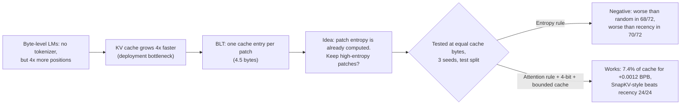
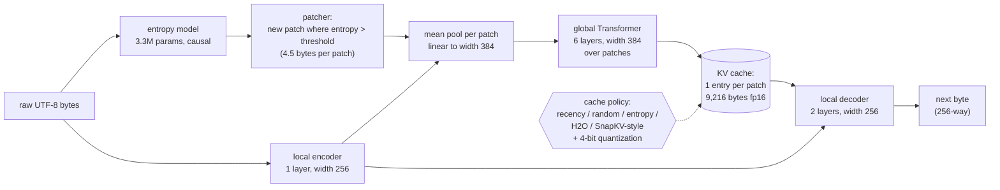
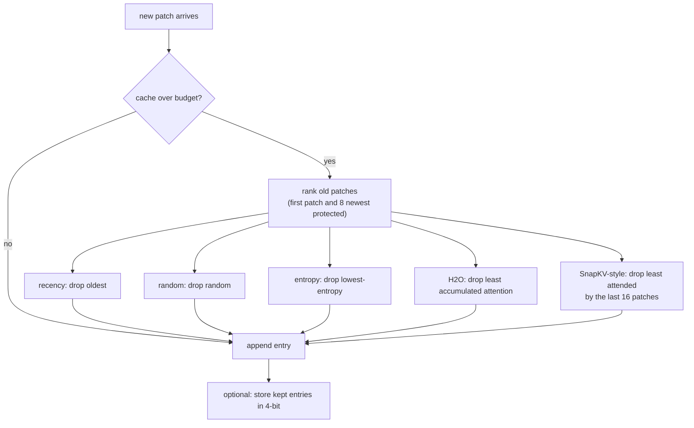
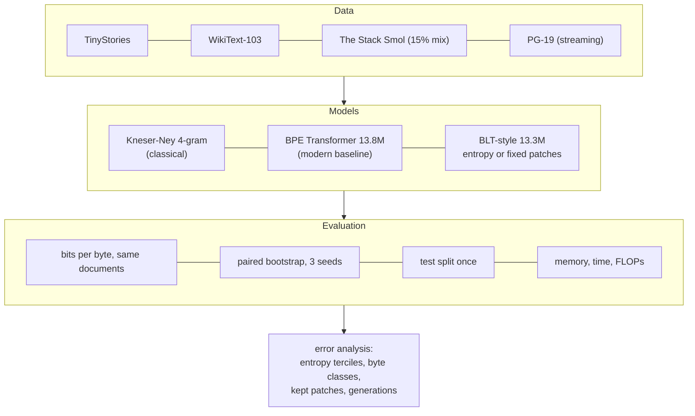
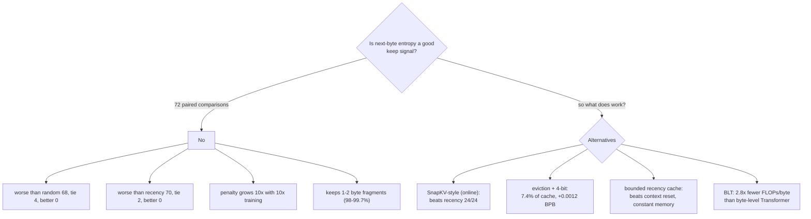
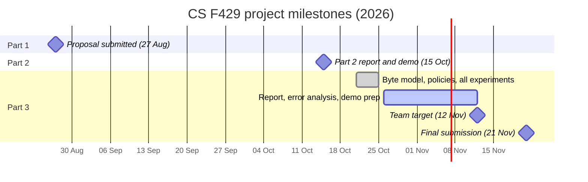
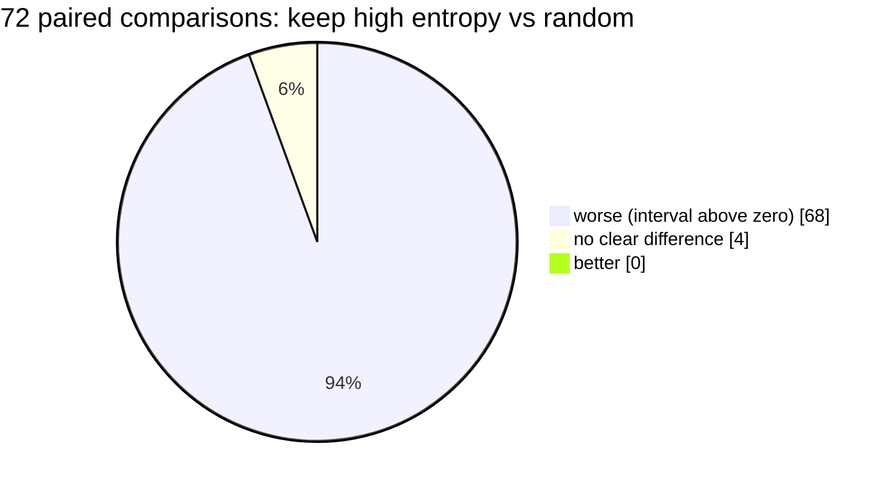
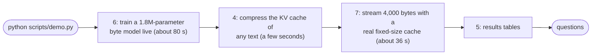
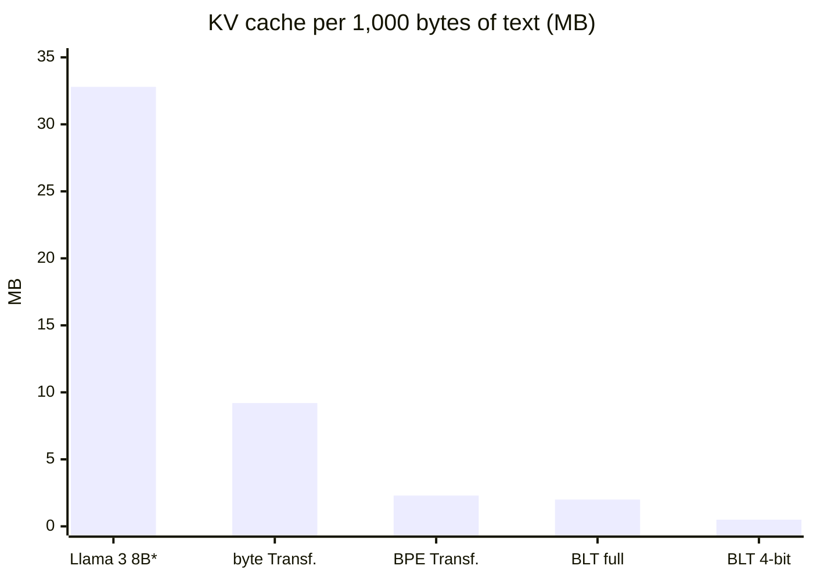

# Diagrams for the talk (Mermaid)

Diagrams in aid of explanation at the viva and the presentation. They render on GitHub and in any Markdown viewer that speaks Mermaid; PNG copies for the slides live in `report/presentation/mermaid/` (rebuilt by `python scripts/render_mermaid.py`, which needs `pip install playwright` and a Chromium, passed with `--chromium`). The figures are transcribed from `docs/results_summary.md` and `results/part3/`.

## 1. The story in one picture

## 2. System pipeline

## 3. What a cache policy does

## 4. Experimental design

## 5. Decision tree of the results

## 6. Timeline of the project

## 7. Outcome of the main test (keep high entropy vs random)

## 8. Demo flow

## 9. KV cache per 1,000 bytes of text (MB, fp16)

\* Llama 3 8B at an assumed 4 bytes per token; about 600 times more parameters than our models, so only the cost structure is comparable (`report/figures/fig_public.pdf`, `configs/public_models.json`).
